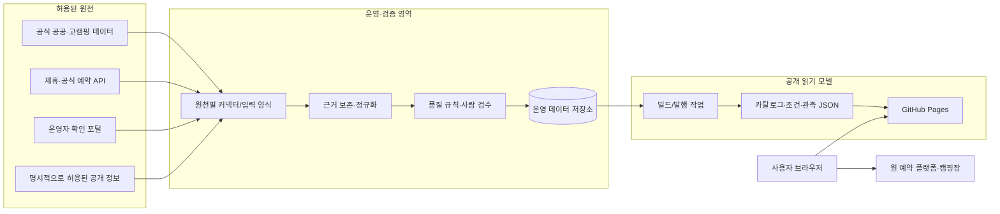

# 모여라캠핑 아키텍처 — 관측 기반 캠핑 의사결정 서비스

> 갱신일: 2026-10-15 KST (v3: 제품 재정의에 맞춘 전면 개정) 
> 제품·상태 정의: [SERVICE_REINVENTION_PLAN.md](./SERVICE_REINVENTION_PLAN.md) 
> 현재 작업 인수인계: [AGENT_HANDOFF.md](./AGENT_HANDOFF.md)

## 1. 목적과 원칙

모여라캠핑은 예약 플랫폼을 복제하지 않는다. 사용자가 `이번 주말`, `내 차`, `내 텐트`,
`아이 동반`, `전기·불멍` 조건으로 **갈 만한 곳을 빠르게 좁히고**, 언제 어떤 근거로
빈자리를 확인했는지 판단할 수 있게 하는 서비스다.

아키텍처의 핵심 원칙은 다음과 같다.

1. **카탈로그와 예약 가능성은 분리한다.** 캠핑장 기본 정보는 장기 데이터이고,
   빈자리는 원천·시각·상태가 있는 단기 관측 데이터다.
2. **사실·추론·사용자 선호를 분리한다.** 원문 근거가 있는 시설·규정은 사실로,
   적합도는 설명 가능한 계산 결과로, 사용자 프로필은 브라우저 안의 선택값으로 다룬다.
3. **현재 재고를 과장하지 않는다.** 실시간 예약 가능은 계약/공식 API의 `LIVE_AVAILABLE`만
   사용한다. 그 외는 `OBSERVED_AVAILABLE`로 표기하고 관측 시각을 함께 보인다.
4. **원천 권한이 제품 기능의 경계다.** 제휴·공식 API·운영자 확인·허용된 공개 정보만
   자동 처리한다. 예약 플랫폼 화면을 탐지 회피 방식으로 수집하지 않는다.
5. **읽기는 정적으로, 쓰기는 검증 가능하게 운영한다.** 공개 탐색은 GitHub Pages의
   정적 읽기 모델로 빠르게 제공하고, 입력·검증·변경 이력은 분리된 운영 영역에서 관리한다.

## 2. 현재와 목표 상태

| 구분 | 현재: 카탈로그 단계 | 목표: 관측 파일럿 이후 |
| --- | --- | --- |
| 공개 서비스 | GitHub Pages 정적 탐색 | GitHub Pages 정적 탐색 + 최근 관측 필터 |
| 기준 데이터 | 고캠핑·수동 검증 데이터 | 기존 데이터 + 근거가 있는 조건·대여·시설 데이터 |
| 빈자리 | 예약 링크와 예약 규칙 안내 | 원천·시각·신뢰도가 있는 관측 이력 |
| 운영 저장소 | 저장소의 정적 JSON·검수 문서 | 운영 DB + 검수 이력 + 정적 읽기 모델 |
| 개인화 | URL/브라우저 필터 | 동일. 로그인·개인정보 저장은 필수가 아님 |
| 예약 | 외부 예약처로 이동 | 외부 예약처로 이동, 재고 보장·결제는 하지 않음 |

현재 구현을 부정하거나 한 번에 교체하지 않는다. 기존 `campground`, `zone`, `product`,
`inventory_unit` 카탈로그와 탐색 화면은 유지하고, 권한이 확보된 원천부터 운영 데이터를
추가한다.

## 3. 목표 구조

### 3.1 책임 경계

| 영역 | 책임 | 공개 여부 |
| --- | --- | --- |
| 원천 커넥터 | 원천 권한·요청 한도·수집 시각 기록 | 비공개 |
| 근거/검수 | URL, 원문 발췌, 확인일, 충돌·만료 상태 보존 | 운영용, 핵심 출처만 공개 |
| 운영 DB | 정규화된 사실과 관측 이력의 원본 | 비공개 |
| 읽기 모델 | 검색에 필요한 최신 승인값과 관측 요약 | 공개 정적 JSON |
| 프런트엔드 | 조건 필터, 비교, 출처·시각 안내, 예약 이동 | 공개 |
| 예약·결제 | 예약 사업자와 캠핑장의 책임 | 모여라캠핑 범위 밖 |

## 4. 데이터 계약

### 4.1 카탈로그 및 조건 사실

기존 캠핑장·구역·상품 모델을 유지한다. 새 사실은 캠핑장 전체 값으로 뭉개지지 않도록
`캠핑장 → 구역 → 사이트/상품` 범위를 함께 저장한다.

| 모델 | 핵심 항목 | 반드시 남길 메타데이터 |
| --- | --- | --- |
| `condition_fact` | 주차 방식, 최대 전력 W, 바닥, 사이트 가로·세로, 숯·장작 가능 여부, 캐노피/타프 규정 | 적용 범위, 원문 URL/발췌, 확인일, 신뢰도, 검수 상태 |
| `rental_offer` | 대여 물품, 가격, 보증금, 수량/사전예약 여부 | 적용 기간, 출처, 확인일 |
| `facility_feature` | 수영장·에어바운스·체험·계곡·산책로, 화장실·샤워실 유형/수량, 동반 아동 관련 조건 | 위치/시즌, 출처, 확인일 |
| `capacity_snapshot` | 오토사이트·카라반·글램핑 등 상품 수량 및 면적 정보 | 기준일, 출처, 검수 상태 |

코드값은 검색 가능한 표준값과 원문을 모두 갖는다. 예를 들어 `PARKING_MODE`는
`SITE_ADJACENT`, `SHARED_NEARBY`, `DROP_OFF_EXTERNAL`, `CART_REQUIRED`로 정규화하되,
“텐트 옆 1대 가능” 같은 원문과 적용 사이트를 보존한다. ‘정보 없음’과 ‘불가’를 같은
값으로 저장하지 않는다.

### 4.2 예약 가능 관측

`availability_observation_run`은 한 번의 허용된 조회/입력 작업을,
`availability_observation`은 날짜·상품별 결과를 표현한다.

| 상태 | 뜻 | 사용자에게 보이는 방식 |
| --- | --- | --- |
| `LIVE_AVAILABLE` | 제휴 또는 공식 API가 현재 예약 가능을 보장 | “실시간 확인”, 갱신 시각, 예약 이동 |
| `OBSERVED_AVAILABLE` | 특정 시각에 예약 가능한 상품을 관측 | “최근 빈자리 확인”, 원천·확인 시각·만료 기준 |
| `OBSERVED_UNAVAILABLE` | 더 최근의 정상 관측에서 빈자리를 보지 못함 | 기본 목록에서 숨김, 이력에서는 표시 |
| `OFFICIAL_APPLICATION_OPEN` | 공식 추첨/접수 기간이 열림 | 접수 일정과 공식 링크 |
| `UNKNOWN` / `OBSERVATION_FAILED` | 확인하지 못했거나 결과를 신뢰할 수 없음 | 빈자리로 노출하지 않음 |

관측에는 `observed_at`, `source_type`, `source_ref`, `target_date`, `product_scope`,
`confidence`, `expires_at`을 필수로 둔다. 기본 목록은 36시간 이내의
`OBSERVED_AVAILABLE`만 보여 주고, 이후 정상 관측에서 `OBSERVED_UNAVAILABLE`이 나오면
목록에서는 내린다. 이는 ‘매진’ 선언이 아니라 “더 이상 최근 빈자리 근거가 없다”는 처리다.

### 4.3 사용자 선호와 적합도

인원, 차량, 텐트 크기, 전력 요구량, 불멍/숯불, 자녀 나이 등의 선택은 기본적으로
브라우저에만 저장한다. 적합도는 서버의 불투명한 추천 점수가 아니라 다음처럼 이유를
설명할 수 있어야 한다.

- 필수 조건 충족/미확인/불충족을 각각 구분한다.
- `텐트 옆 주차`, `700W 이상`, `한 변 7m 이상`, `장작 가능` 같은 조건은 근거가 있는
  사이트/구역까지 내려가 판단한다.
- 미확인 값은 통과 처리하지 않으며, 사용자가 ‘미확인 포함’을 선택할 때만 넓힌다.
- 가족·아이 요소는 시설 존재와 시즌·별도 요금·운영 여부를 분리해서 설명한다.

## 5. 수집과 발행 파이프라인

1. **등록**: 원천마다 계약/약관/허용 범위, 필드 매핑, 최대 요청량, 담당자를 등록한다.
2. **입력**: 커넥터 또는 운영자 입력 양식이 원문 근거와 함께 초안 레코드를 만든다.
3. **검증**: 형식 검증, 범위 충돌 탐지, 만료 확인, 표본 사람 검수를 수행한다.
4. **승인**: 승인된 사실/관측만 운영 DB의 현재값 및 이력으로 승격한다.
5. **발행**: 정적 읽기 모델을 만들고 스키마·링크·상태 전이·데이터 신선도를 검사한다.
6. **표시**: 페이지는 기준 시각과 출처를 표시하고, 예약 동작은 원천 사업자로 넘긴다.

허용된 자동 작업도 실행 시각·횟수·성공/실패를 남긴다. 사용자의 업무 시간인 평일
08:00~18:00 KST는 기본 실행 창에서 제외할 수 있으나, 이는 서비스 부하 조절을 위한
운영 규칙일 뿐 원천의 탐지나 제한을 우회하기 위한 설계가 아니다.

## 6. 배포와 운영

### 6.1 단계별 인프라

| 단계 | 저장·처리 | 배포 | 시작 조건 |
| --- | --- | --- | --- |
| 0. 현재 | Git 저장소의 정적 카탈로그·검수 문서 | GitHub Actions → GitHub Pages | 즉시 운영 |
| 1. 조건 파일럿 | 정적 데이터 + 검수 큐 | 동일 | 20~30개 캠핑장에 근거 필드 채움 |
| 2. 관측 파일럿 | 운영 DB(예: 관리형 PostgreSQL) + 발행 작업 | 정적 읽기 모델 → GitHub Pages | 승인된 관측 원천 확보 |
| 3. 확장 | 원천별 워커·품질 대시보드·재처리 큐 | 동일 | 신선도·정확도 기준 충족 |

공개 읽기 경로는 캐시 가능한 정적 파일을 유지한다. 운영 DB를 곧바로 브라우저에 열지
않으며, 원문 전체나 제휴 자격 증명도 공개 빌드에 포함하지 않는다.

### 6.2 품질 규칙과 관측성

- 모든 공개 조건값은 `근거 URL 또는 운영자 확인`, `확인일`, `적용 범위`를 가져야 한다.
- 전력·사이트 크기·주차·화기 규정처럼 여행 결정을 바꾸는 필드는 충돌 시 자동으로
  하나를 선택하지 않고 `확인 필요`로 낮춘다.
- 발행 전 `필수 시각 누락`, `미래 시각`, `만료된 관측`, `불가능한 면적/전력값`,
  `상태 전이 오류`, `깨진 예약 링크`를 검사한다.
- 운영 지표는 원천별 성공률, 관측 신선도, 근거 보유율, 충돌률, 상세 열람 후 외부 예약
  이동률, 사용자 ‘정보 다름’ 신고율로 본다.
- 예약 가능 관측은 정확도가 일정 기준에 못 미치거나 권한이 불명확하면 확장하지 않고
  중단한다.

## 7. 보안·개인정보·권한

- API 키, 제휴 자격 증명, 운영자 연락처는 비공개 비밀 저장소와 운영 DB에만 둔다.
- 기본 탐색과 조건 비교는 로그인 없이 작동하며, 사용자 프로필은 로컬에 둔다.
- 신고나 알림 등 계정 기능을 도입할 때에만 최소 개인정보·보존 기간·삭제 흐름을 별도
  설계한다.
- 사용자 후기·사진·예약 상세 같은 타 플랫폼 원천 데이터는 재게시하지 않는다. 직접
  만든 요약, 허가된 데이터, 외부 원문 링크의 경계를 분명히 한다.

## 8. 협업과 변경 관리

Claude와 Codex를 포함한 작업자는 이 문서와 `SERVICE_REINVENTION_PLAN.md`를 공통 계약으로
사용한다.

1. 상태명, 필드명, 원천 정책을 바꾸면 두 문서와 `AGENT_HANDOFF.md`를 같은 변경에서 갱신한다.
2. 한 작업자는 스키마/파이프라인, 다른 작업자는 화면/표시 규칙처럼 파일 경계를 나눠
   같은 파일을 덮어쓰지 않는다.
3. 관측 상태·공개 표시·원천 권한이 바뀌는 변경은 테스트 데이터와 화면 문구를 함께 검토한다.
4. 소스 권한이 불명확하면 데이터 수집 코드를 먼저 만들지 않고, 해당 원천을 `보류`로 남긴다.

## 9. 다음 구현 관문

첫 구현 단위는 ‘전국 일괄 자동 수집’이 아니라 **20~30개 캠핑장 조건 깊이화 + 승인된
관측 원천 1개**다. 이 파일럿에서 다음을 확인한 뒤 확장한다.

- 조건 필드가 실제 예약 결정을 줄여 주는가
- 최근 관측 표시가 현재 재고로 오해되지 않는가
- 근거·신선도·충돌 검수가 운영 가능한가
- 원천 정책과 호출 한도를 안정적으로 지킬 수 있는가

이 관문을 통과하면 `db/008`로 조건 사실·대여·시설·관측 이력 모델을 추가하고, 정적
읽기 모델과 화면 필터를 순서대로 연결한다.
