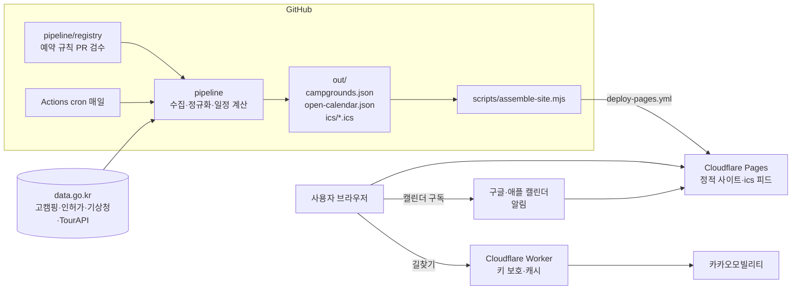

# 아키텍처 — 무료 운영 우선, GitHub 중심

> 갱신일: 2026-10-12 KST (v2: 무료 운영·로그인 없음 전제로 개정) 
> 소유자 작업 목록: [OWNER_TODO.md](./OWNER_TODO.md)

## 1. 결론

로그인 없이 시작하면 **서버도 DB도 없이** 핵심 기능 3개를 모두 무료로 운영할 수 있다.

| 기능 | 어떻게 무료로 | 쓰는 서비스 |
| --- | --- | --- |
| 캠핑장 데이터 수집 | GitHub Actions 예약 실행(매일)이 공공 API를 호출하고 정적 JSON을 만든다 | GitHub Actions, data.go.kr |
| 검색·상세 화면 | 정적 사이트 + 브라우저 안에서 필터링 | Cloudflare Pages |
| 관심 캠핑장 | 브라우저 저장소(localStorage). 기기 간 동기화는 로그인 도입 시 | – |
| **예약 오픈 알림** | `.ics` 캘린더 구독 피드를 정적 파일로 배포 → 사용자의 캘린더 앱이 하루 전·10분 전 알림 | Cloudflare Pages (정적 파일) |
| 지도 | 카카오 지도 JavaScript SDK(도메인 제한 키) | Kakao Developers |
| 이동시간·통행료 | 키를 숨기는 작은 서버 함수 + 10분 캐시 | Cloudflare Workers 무료 한도, 카카오모빌리티 |
| 주변 화장실 | 공중화장실 전국 파일/API를 매일 수집 → 카카오 지오코딩(캐시, 새 주소만) → 캠핑장별 가까운 화장실 계산 → 정적 JSON | GitHub Actions(cache), 카카오 로컬 |
| 날씨 | Actions가 캠핑장 격자별 예보를 3시간마다 받아 정적 JSON으로 배포(사용자 수와 무관하게 호출량 고정) | 기상청 API, Cloudflare Pages |

GitHub Pages 대신 Cloudflare Pages를 쓰는 이유: 저장소가 비공개면 GitHub Pages가 유료이고, 길찾기 키를 숨기는 서버 함수(Workers)가 같은 곳에 있어야 하기 때문이다. 배포는 GitHub Actions가 한다(`deploy-pages.yml`).

## 2. 구조

## 3. 무료 한도와 사용량 추정 (2026-10 기준, 각 서비스 공지로 재확인 필요)

| 서비스 | 무료 범위(요약) | 예상 사용량 | 여유 |
| --- | --- | --- | --- |
| GitHub Actions | 공개 저장소 무제한 / 비공개 월 2,000분 | 동기화·배포 하루 3~5분 → 월 150분 | 충분 |
| Cloudflare Pages | 정적 요청·대역폭 무제한, 월 500회 빌드 | 하루 1~3회 배포 | 충분 |
| Cloudflare Workers | 하루 10만 요청 | 길찾기만, 캐시 후 수백~수천 | 충분 |
| data.go.kr | 무료, 개발계정 1,000~10,000건/일, 활용사례 등록 시 증량 | 고캠핑 전체 적재 5~6회 호출/일 | 충분. 날씨는 격자 단위 묶음 호출로 관리 |
| 카카오 지도·로컬 | 일 호출 한도 내 무료 | 지도 로드 = 사용자 수 | 서비스 성장 시 점검 |
| 카카오모빌리티 길찾기 | 무료 호출 한도 확인 필요 | 캐시 적중 후 수백/일 | 한도 확인 후 캐시 TTL 조정 |

비용이 생기는 시점: 사용자가 많아져 카카오 한도를 넘을 때, 로그인·기기 간 동기화·푸시 알림을 도입할 때(그때도 Cloudflare D1/KV 무료 한도로 시작 가능), 자체 도메인을 살 때.

## 4. 로그인 없이 알림을 주는 방법

1. **캘린더 구독(지금)**: `ics/provider-knps.ics`처럼 예약처별·캠핑장별 피드를 정적 파일로 배포한다. 사용자가 주소를 캘린더 앱에 한 번 추가하면 이후 일정 변경도 자동 반영되고, 알림은 캘린더 앱이 보낸다. 서버·개인정보 저장이 없다.
2. **관심 캠핑장 묶음 피드(다음)**: 관심 목록 ID를 주소에 담아(`/ics/mine.ics?c=a,b,c`) Worker가 즉석에서 합친 피드를 돌려준다. 저장하는 개인정보가 없다.
3. **웹 푸시(로그인 검토 시)**: 브라우저 푸시 구독을 Workers KV에 저장하고 Worker Cron이 발송. 이때 개인정보 처리방침이 필요하다.

## 5. 워크플로

| 워크플로 | 트리거 | 하는 일 |
| --- | --- | --- |
| `web-quality.yml` | PR, main | `camping-atlas` 린트·빌드 |
| `pipeline-quality.yml` | PR, main | 파이프라인 테스트, 규칙 검증, 캘린더·ics 생성 확인 |
| `data-sync.yml` | 매일 03:17 KST, 수동 | 고캠핑 동기화(키 있을 때), 캘린더·ics 생성, 결과 아티팩트 |
| `deploy-pages.yml` | main 반영, 매일 03:47 KST, 수동 | ics 생성 → `site/` 조립 → Cloudflare Pages 배포(Secret 없으면 건너뜀) |

## 6. 사이트 소스 전환 계획

- 지금: `design/mockup-v2`(정적 시안) + `ics` 피드를 배포해 외부 주소를 먼저 만든다.
- 다음: 시안 승인 후 `camping-atlas` 앱(Next/vinext)에 이식하고 정적 내보내기 또는 Pages Functions로 배포한다. 이식 시 예시 데이터를 `pipeline/out/*.json`으로 교체한다.
- 현재 ChatGPT Sites 배포(`moyeora-camping.magicsiren32.chatgpt.site`)는 GitHub와 연동되지 않으므로 Cloudflare 주소가 생기면 대표 주소를 옮긴다.
