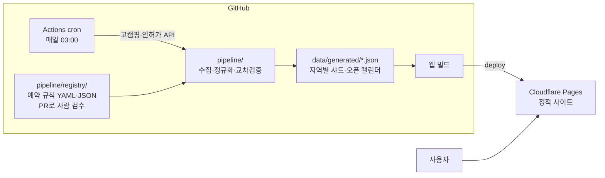

# 아키텍처 제안 — GitHub 중심 + 꼭 필요한 외부 서비스

> 작성일: 2026-10-12 KST 
> 상태: **제안** (결정 대기 항목은 `docs/PROJECT_PLAN.md`의 결정 대기에 반영)

## 1. 결론 요약

GitHub Actions로 개발·검사·데이터 수집·배포를 돌리는 방식은 이 서비스에 잘 맞는다. 캠핑장 기준 데이터와 예약 규칙은 **하루~한 달 단위로 바뀌는 데이터**라서, 스케줄 Action이 수집하고 정적 JSON으로 빌드해 배포하는 구조로 초기 서비스를 충분히 운영할 수 있다.

다만 아래 네 가지는 GitHub만으로 안전하게 처리할 수 없어 외부 서비스가 필요하다.

| 필요 | 왜 GitHub만으로 안 되는가 | 제안 | 비용(초기) |
| --- | --- | --- | --- |
| **API 키를 숨기는 서버 함수** | 길찾기(톨비)·검색 API는 비밀키가 필요해 브라우저에 넣을 수 없다. Pages는 정적 호스팅뿐이다. | **Cloudflare Workers** (현재 프로토타입도 Workers 기반 vinext) | 무료 10만 요청/일 |
| **사용자 데이터·지리 검색 DB** | 저장목록·알림 구독·운영자 입력은 쓰기 DB가 필요하다. 기존 스키마는 PostgreSQL 16 전제다. | **Supabase**(PostgreSQL + PostGIS + Auth) — 기존 `db/001_initial_schema.sql`을 거의 그대로 사용 | 무료 플랜 → Pro $25/월 |
| **예약 오픈 알림 발송** | Actions cron은 지연(수 분~수십 분)이 있어 “09:00 오픈” 알림에 부정확하다. | Cloudflare Workers Cron Triggers(분 단위) + Web Push, 이후 카카오 알림톡(솔라피 등 발송대행) | Web Push 무료, 알림톡 건당 과금 |
| **이미지 저장·리사이즈** | 운영자 사진 원본을 Git에 넣으면 저장소가 비대해진다. | **Cloudflare R2** + Images 변환 | R2 10GB 무료 |

호스팅은 **Cloudflare Pages(또는 Workers Assets)를 GitHub Actions로 배포**하는 것을 권한다. 저장소가 비공개라 GitHub Pages는 유료 플랜(Pro 이상)이 필요하고, 어차피 Workers가 필요하므로 한 곳에 모으는 편이 단순하다.

> 현재 공개 주소(`moyeora-camping.magicsiren32.chatgpt.site`)는 ChatGPT Sites에 배포돼 있어 GitHub 푸시로 갱신되지 않는다. GitHub Actions 배포로 옮기면 PR마다 미리보기 URL도 자동으로 생긴다.

## 2. 단계별 구조

### 1단계 — 지금 바로 (키만 있으면 됨)

- `pipeline/`의 Node 스크립트가 고캠핑 전체 목록을 받고 상품 유형·사이트 규격을 정규화한다.
- 예약 규칙은 `pipeline/registry/`의 파일로 관리하고 **PR 리뷰를 사람 검수 단계로 쓴다**. 규칙마다 원문 URL·확인일·신뢰 등급이 필수다(없으면 테스트 실패).
- 오픈 캘린더 이벤트는 규칙에서 계산해 JSON으로 만든다.
- 생성 데이터는 Git 커밋 대신 Actions 아티팩트/배포 산출물로 두는 것을 기본으로 한다(저장소 비대화 방지). 변경 이력이 필요한 레지스트리만 Git에 둔다.

### 2단계 — 사용자 기능

- Cloudflare Worker: `/api/route`(길찾기·톨비 프록시, 응답 캐시 10분), `/api/weather`(기상청 응답 캐시 1~3시간), `/api/search`(필요 시).
- Supabase: 저장목록, 알림 구독, 운영자 계정. Row Level Security로 사용자 데이터 분리.
- Worker Cron(매 분): 다가오는 오픈 이벤트 → Web Push 발송.

### 3단계 — 운영자·예약 연동

- 운영자 포털(Supabase Auth + 사업자 인증), 사진 업로드(R2), 상품·요금·오픈 규칙 입력.
- 제휴 예약 API 어댑터는 Worker 또는 별도 큐(Cloudflare Queues)로 처리.
- 검색량이 커지면 PostGIS + 검색 인덱스(Typesense/Meilisearch Cloud 또는 OpenSearch)로 확장.

## 3. GitHub Actions 워크플로 구성

| 워크플로 | 트리거 | 하는 일 |
| --- | --- | --- |
| `web-quality.yml` (기존) | PR, main 푸시 | 웹 설치·린트·빌드 |
| `pipeline-quality.yml` (신규) | PR, main 푸시 | 파이프라인 단위 테스트, 레지스트리 검증(출처·확인일 필수) |
| `data-sync.yml` (신규) | 매일 cron + 수동 | 고캠핑·인허가 동기화, 오픈 캘린더 계산, 결과를 아티팩트로 업로드. 키가 없으면 레지스트리 기반 계산만 수행 |
| `deploy.yml` (결정 후) | main 푸시, data-sync 완료 | Cloudflare Pages 배포, PR 미리보기 |

필요한 GitHub Secrets(이름만, 값은 저장소에 넣지 않음): `DATA_GO_KR_SERVICE_KEY`, `CLOUDFLARE_API_TOKEN`, `CLOUDFLARE_ACCOUNT_ID`, 이후 `NCP_MAPS_CLIENT_ID/SECRET` 또는 `KAKAO_REST_KEY`, `SUPABASE_*`.

## 4. 사용자가 결정할 것

1. Cloudflare 계정 생성 및 API 토큰 발급 동의 (호스팅 이전)
2. data.go.kr 인증키 발급(고캠핑, 인허가, 기상청, 에어코리아, 천문연, TourAPI) — 개인 계정으로 가능
3. 길찾기 공급자: NAVER Cloud Directions 5(톨비 응답 포함, 유료) vs 카카오모빌리티(무료 쿼터 있음)
4. Supabase 도입 시점(저장목록·알림 기능 착수 시)
