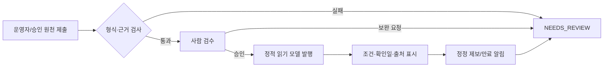

# 파일럿 원천·운영자 입력 계약

> 버전: 1.1 · 2026-10-15 KST<br>
> 연결 문서: [서비스 재정의 계획](./SERVICE_REINVENTION_PLAN.md), [아키텍처](./ARCHITECTURE.md)<br>
> 대상: 최근 관측 빈자리와 현장 조건 데이터를 제공·검수하는 운영자 및 승인된 데이터 원천

## 1. 목적과 범위

이 문서는 전국 데이터를 한 번에 채우기 위한 크롤링 명세가 아니다. 파일럿 캠핑장 20~30곳이
사용자의 실제 준비 판단에 필요한 조건을 **근거와 함께** 입력·갱신하고, 허용된 원천의
빈자리 관측을 신뢰성 있게 표시하기 위한 운영 계약이다.

입력자는 값만 제출하지 않는다. 모든 중요한 값에 적용 범위, 근거 URL 또는 운영자 확인,
확인일, 유효 기간을 함께 제출한다. 렛츠 캠핑은 이 정보를 예약 플랫폼의 실시간 재고나
타 플랫폼 후기·사진을 재게시하는 용도로 사용하지 않는다.

### 파일럿의 완료 기준

다음 세 가지가 모두 충족된 시설만 ‘조건 깊이화 파일럿’으로 공개한다.

1. 사이트/구역별 주차, 전력, 크기, 바닥, 화기 조건에 근거가 있다.
2. 대여·위생·아이 시설처럼 운영 시기에 따라 달라지는 정보에는 확인일과 시즌 조건이 있다.
3. 빈자리 정보가 있으면 허용된 원천·관측 시각·대상 날짜·인원 조건을 함께 보여 줄 수 있다.

## 2. 원천 등록과 승인 게이트

커넥터나 운영자 입력을 시작하기 전에 원천별로 아래 카드를 작성한다. 카드를 승인하지
않은 원천은 자동 조회·정적 발행 대상이 아니다.

| 항목 | 필수 내용 |
| --- | --- |
| 원천 ID / 담당자 | 고유 ID, 조직명, 기술·운영 담당자 |
| 방식 | 공식 API / 서면 제휴 파일 / 운영자 인증 입력 / 재배포가 허용된 공식 공개 정보 |
| 허용 범위 | 읽을 필드, 시설·상품 범위, 보관·재배포 가능 여부 |
| 빈자리 권한 | 실시간 재고인지, 단순 관측인지, 수량 제공 여부 |
| 요청 정책 | 최대 요청량, 실행 가능 시간, 인증 방식, 실패 시 중단 조건 |
| 근거 | 계약서·약관·API 문서·운영자 확인 URL 또는 문서 |
| 갱신·철회 | 데이터 갱신 주기, 정정 연락처, 이용 허가 철회 처리 |

### 승인 판정

| 결과 | 처리 |
| --- | --- |
| `APPROVED_LIVE` | 상품·날짜·인원 조건의 현재 재고를 계약/API로 확인 가능. `LIVE_AVAILABLE` 후보가 될 수 있음 |
| `APPROVED_OBSERVATION` | 특정 시각의 예약 화면/목록 상태만 허용 범위 안에서 확인 가능. `OBSERVED_*`만 발행 |
| `APPROVED_FACTS_ONLY` | 시설 조건·공지·대여 등 정적 사실만 허용. 빈자리 기능에는 쓰지 않음 |
| `MANUAL_REVIEW_ONLY` | 사람이 근거를 확인해 입력 가능. 자동 요청·재발행은 하지 않음 |
| `PENDING` / `REJECTED` | 검수 큐에만 보관하고 사용자 화면에 발행하지 않음 |

예약 화면의 자동 수집은 제휴·공식 API·명시적 허가가 있을 때에만 `APPROVED_*`로 올릴 수
있다. 호출 시간을 숨기거나 플랫폼의 제한을 피하는 방식은 사용하지 않는다.

### 2.1 전국 발견 신호와 파일럿 사실의 경계

고캠핑의 구조화 필드·운영자 소개글에서 얻는 전국 단위 값은 후보를 찾는 데 유용하지만,
문장 키워드나 시설 분류만으로 사이트 옆 주차·최대 W·장작 허용을 확정할 수는 없다.
아래 등급을 혼용하지 않는다.

| 등급 | 쓰임 | 내 캠핑 세팅에서의 판정 |
| --- | --- | --- |
| `VERIFIED` | 사람 검수자가 핵심 항목별 원문·확인일·재검수일을 남긴 파일럿 사실 | `맞음` / `조건부` / `맞지 않음` 판정 가능 |
| `CONFIRMED` | 고캠핑의 직접 구조화 필드처럼 의미가 명확한 등록값 | 해당 필드 자체는 표시하되, 다른 의미로 확장하지 않음 |
| `SURVEYED` | 소개글·시설 분류에서 발견한 후보 신호 | 카드 탐색 보조 정보만. 고위험 적합 판정은 `확인 필요` |
| `PARTIAL` / `UNKNOWN` | 일부만 있거나 근거가 없는 값 | 가능/불가로 추정하지 않음 |

특히 다음 변환은 금지한다.

- 자동차야영장/오토 사이트 수 → 텐트 옆 주차 확정
- 법정·권고 전력 수치 → 해당 시설의 실제 `POWER_MAX_W`
- 장작 판매/화로대 대여 → 장작 사용 허용
- 사이트 면적 계산 → 타프·캐노피 설치 허용
- 시설 소개의 수영장·체험 언급 → 해당 날짜의 운영 보장

`pipeline/registry/pilot-review-queue.json`은 이 경계를 지키는 검수 대기열이다. 후보의
공식 URL만 보관하며 조건 사실은 담지 않는다. 사람이 대조를 끝내고 각 핵심 항목을 기록한
뒤에만 `pilot-condition-facts.json`으로 승격한다.

## 3. 운영자 조건표 입력 단위

시설 전체 값과 사이트별 값이 섞이면 잘못된 추천이 나온다. 따라서 각 항목은 다음 범위 중
하나를 반드시 선택한다.

| 범위 | 예시 |
| --- | --- |
| `CAMPGROUND` | 전체 입실 시간, 계곡·산책로, 공용 화장실 수 |
| `ZONE` | A존의 공용 주차장, A존 샤워실 |
| `PRODUCT` | ‘오토 A-3’ 상품의 정원·가격·전기 제공 |
| `SITE` | A-3 실제 가로×세로, 데크/파쇄석, 차량 1대 옆 주차 |

값이 ‘일부 사이트만 가능’이면 시설 전체에 `가능`이라고 쓰지 않는다. 범위를 좁히거나
`조건부`로 입력하고 해당 사이트명을 적는다.

## 4. 필수 조건표

### 4.1 차량·사이트·장비

| 사용자에게 보일 항목 | 표준 입력 | 추가로 필요한 근거/설명 |
| --- | --- | --- |
| 주차 동선 | `SITE_ADJACENT` / `SHARED_NEARBY` / `DROP_OFF_EXTERNAL` / `CART_REQUIRED` | 사이트 옆 허용 차량 수, 짐수레/도보 거리, 도착 후 이동 제한 |
| 사이트 크기 | `width_m`, `depth_m`, 또는 불규칙 형태 설명 | 실제 설치 가능 공간인지, 데크 외 여유 공간 포함 여부 |
| 바닥 | `DECK` / `GRAVEL` / `GRASS` / `SOIL` / `MIXED` | 데크 규격·팩 사용 제한·방수포 주의 |
| 텐트·타프·쉘터 | 텐트 수, 타프/쉘터 허용, 캐노피 금지 여부 | 3×3 캐노피를 타프 대용으로 허용하는지, 총 설치 개수·최대 규격 |
| 전기 | 제공 여부, `max_w`, 콘센트 위치, 추가 요금 | W가 불명확하면 ‘전기 제공, W 확인 필요’로 입력. A(암페어)를 W로 임의 변환하지 않음 |

### 4.2 화기·인원·반려동물

| 항목 | 표준 입력 | 반드시 적을 조건 |
| --- | --- | --- |
| 숯불 | `ALLOWED` / `PROHIBITED` / `DESIGNATED_ONLY` / `UNKNOWN` | 화로대 필수, 지정 장소, 우천·산불 경보 시 중단 여부 |
| 장작 불멍 | `ALLOWED` / `PROHIBITED` / `DESIGNATED_ONLY` / `UNKNOWN` | 장작 판매/반입, 데크 보호판, 개별 화로 사용 가능 여부 |
| 인원 | 기준·최대 인원, 추가 인원 요금, 방문객 규정 | 가족 외 방문객 허용/불가, 야간 방문·차량 추가 제한 |
| 반려동물 | 가능 여부·견종/무게·구역 제한 | 추가 요금, 리드줄, 실내 시설 출입 규정 |

### 4.3 편의·대여·아이 활동

| 항목 | 표준 입력 | 사용자 판단에 필요한 세부값 |
| --- | --- | --- |
| 화장실·샤워·개수대 | 공용/개별, 동별 수량, 온수 | 객실/사이트 전용 여부, 이용 시간, 유료 여부, 청소 시간 |
| 대여 | 품목, 1박 가격, 보증금, 수량/사전예약 | 텐트·화로·릴선·전기장판·침구·식기 구분, 현장 재고 여부 |
| 아이 시설 | 수영장·에어바운스·놀이터·체험·프로그램 | 운영 기간, 연령/신장 제한, 예약·별도 요금, 우천 휴장 |
| 자연·동선 | 계곡·천·산책길·낚시·매점 | 시설 내부/도보 거리 구분, 안전·수심·계절 제한 |

## 5. 제출 레코드 계약

운영 화면·CSV·API 중 형식은 달라도 아래 의미는 변하지 않는다. `value`와 원문·검수
메타데이터를 분리해, 한 값이 다른 출처의 값을 조용히 덮어쓰지 않게 한다.

```json
{
  "campground_external_id": "gocamping:1234",
  "scope": { "type": "SITE", "external_id": "A-03", "display_name": "A존 3번" },
  "field_code": "POWER_MAX_W",
  "value": { "watts": 1000, "included": true, "extra_fee_krw": 0 },
  "source": {
    "type": "OPERATOR_VERIFIED",
    "url": "https://example-camp.kr/notice/power",
    "excerpt": "A존 사이트당 최대 1,000W 사용 가능",
    "published_at": "2026-10-01",
    "confirmed_at": "2026-10-15"
  },
  "validity": { "starts_on": "2026-10-01", "ends_on": null },
  "submission": { "status": "DRAFT", "submitted_by": "operator:example-camp" }
}
```

### 필수 검증

- `campground_external_id`, 범위, 필드 코드, 근거 유형, 확인일은 비어 있을 수 없다.
- 전력 W·수량·요금·가로·세로는 0 이상 숫자여야 하며, 단위와 세금/보증금 포함 여부를 분리한다.
- `SITE_ADJACENT`에는 허용 차량 수가, `CART_REQUIRED`에는 대략적 이동 방식 또는 거리가 필요하다.
- 가격·행사·수영장·대여는 적용 시작일과 종료일 또는 ‘상시’를 명시한다.
- 화기·캐노피·방문객처럼 금지/허용이 바뀔 수 있는 값에는 공지 URL이나 운영자 확인이 필요하다.
- 서로 충돌하는 승인값은 최신값으로 자동 대체하지 않고 `NEEDS_REVIEW`로 보낸다.
- `VERIFIED` 파일럿에는 `source_type`, 검수자, 핵심 항목 코드 목록,
  `next_review_due_at`을 남긴다. 재검수일은 확인일 뒤 180일 이내여야 하며,
  기한이 지나면 해당 필드는 `EXPIRED`/`확인 필요`로 되돌린다.

## 6. 빈자리 관측 제출 계약

빈자리 관측은 사이트 조건표와 별도다. 관측 하나는 ‘특정 시각에, 특정 조건으로,
어느 상품에서 무엇을 봤는가’를 뜻한다.

| 필수 항목 | 설명 |
| --- | --- |
| 원천 승인 ID | 위 승인 카드의 `APPROVED_LIVE` 또는 `APPROVED_OBSERVATION` |
| 대상 | 캠핑장·구역·상품/사이트, 입실일·퇴실일, 인원·차량 조건 |
| 결과 | `LIVE_AVAILABLE`, `OBSERVED_AVAILABLE`, `OBSERVED_UNAVAILABLE`, `OFFICIAL_APPLICATION_OPEN`, `UNKNOWN` |
| 시각 | `observed_at`과 사용자 노출 만료 시각 `expires_at` |
| 근거 | 예약 URL/API 응답 식별자 또는 운영자 확인 참조 |
| 수량 | 원천이 명시하고 보관·표시가 허용된 경우에만 기록 |

관측 결과가 실패하거나 화면이 바뀌면 `OBSERVED_UNAVAILABLE`로 바꾸지 않는다.
`OBSERVATION_FAILED`로 기록하고 마지막 정상 관측의 만료만 자연스럽게 지나가게 한다.

## 7. 검수 흐름과 사용자 표기



| 내부 상태 | 공개 표기 |
| --- | --- |
| `VERIFIED` | 확인됨 · 확인일 및 출처 표시 |
| `CONDITIONAL` | 조건부 · 적용 사이트/시즌/추가 비용 표시 |
| `NEEDS_REVIEW` / `EXPIRED` | 확인 필요 · 가능/불가로 추정하지 않음 |
| `REJECTED` | 공개하지 않음 |

사용자는 ‘전기 있음’ 같은 요약만 보지 않는다. 우선 카드에서는 판정과 핵심 수치를,
상세에서는 적용 사이트·원문·확인일·제한 사항을 본다.

## 8. 파일럿 운영 리듬

| 시점 | 운영 행동 | 산출물 |
| --- | --- | --- |
| 시작 전 | 원천 카드 승인, 운영자 본인 인증, 샘플 1개 검수 | 승인 목록, 입력 계정/양식 |
| 첫 주 | 시설별 핵심 조건표 입력·충돌 해결 | 공개 가능한 조건 사실 |
| 매주 | 만료 예정값·시즌 시설·대여 가격 점검 | 갱신/만료 목록 |
| 관측 실행 전 | 호출 한도·시간·중단 기준 확인 | 실행 계획 |
| 관측 뒤 | 성공률·신선도·오탐 제보 확인 | 관측 이력 및 품질 보고 |
| 월말 | 운영자 정정·사용자 제보 처리 시간 검토 | 파일럿 확대/보류 결정 |

### 8.1 현재 파일럿 확대 순서

1. `pilot-review-queue.json`의 `QUEUED` 후보에서 공식 원문을 사람 검수한다.
2. 주차·전력·규격·바닥·화기·쉘터·위생을 각각 원문 URL·확인일과 대조한다.
3. 불명확한 항목은 비워 두거나 `UNKNOWN`으로 남긴다. 추측으로 완전한 표를 만들지 않는다.
4. 전체 핵심 항목과 재검수일이 갖춰진 시설만 `pilot-condition-facts.json`에 추가한다.
5. 검수 전 후보는 탐색의 ‘조건 검증’ 배지·내 세팅 `맞음` 판정·필터 수치에 넣지 않는다.

실행 시간은 승인된 원천의 정책을 최우선으로 한다. 저부하 창을 쓰더라도 평일
08:00~18:00 KST를 피하는 것은 운영상 선택일 뿐, 자동 수집의 존재나 횟수를 감추기 위한
방법이 아니다.

## 9. 제미나이·코덱스 구현 경계

- 이 문서는 **입력 의미와 검수 기준**만 고정한다. DB 테이블·커넥터·화면 구현은 이 계약을
  만족하는 범위에서 별도 작업자가 맡는다.
- 구현 전에 `field_code`, 공개 상태명, 관측 상태명을 여기와
  `SERVICE_REINVENTION_PLAN.md`에 대조한다.
- 이 문서가 바뀌면 샘플 데이터, 유효성 검사, 사용자 문구를 같은 변경에서 갱신한다.
- 운영자 원문이 없는 값은 기본값·추정값으로 채우지 않는다.
