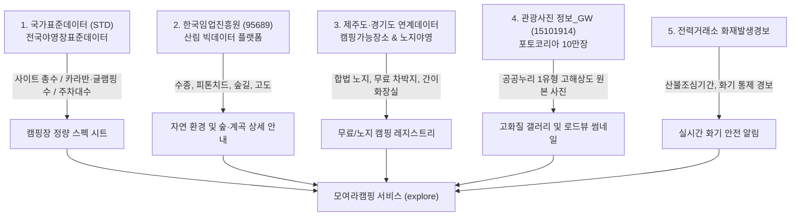

# 공공데이터포털(data.go.kr) 전 분야 캠핑 데이터 수집 및 연계 활용 설계서

> **문서 버전**: v1.0  
> **적용 범위**: 전국 3,116개 캠핑장 카탈로그, 무료/노지 캠핑장 레지스트리, 상세 스펙 시트, 로드뷰 및 고화질 미디어 파이프라인

---

## 1. 개요 및 목적

공공데이터포털(`data.go.kr`)에 등록된 캠핑 관련 데이터는 제공 방식에 따라 5가지 영역으로 나뉩니다:
1. **표준데이터셋 (STD, 1건)**: 국가 공통 표준 규격의 인허가 및 정량 시설 데이터
2. **연계데이터 (LINKED, 30건)**: 산림청(임업진흥원), 경기데이터드림, 제주도 등 전문 플랫폼 연계 데이터
3. **오픈 API (API, 14건)**: 실시간 조회 가능한 REST/JSON/XML 서비스
4. **파일데이터 (FILE, 186건)**: 지자체별 관광과에서 정기 갱신하는 CSV/XLS 파일
5. **산림 빅데이터 플랫폼 (95689)**: 산림 입지, 피톤치드, 수종, 숲길 연계 부가정보

본 문서는 이 방대한 데이터셋을 효과적으로 수집하여, **사용자가 요구한 "총 사이트 수 / 카라반·글램핑 대수", "숲/계곡 상세 정보", "제주·노지 무료 차박지", "고화질 풍경 사진", "화재 위험 알림"**을 서비스에 완벽히 녹여내는 구조를 정의합니다.

---

## 2. 데이터셋별 가치 및 서비스 매핑 전략



### ① 표준데이터셋 (STD): 전국야영(캠핑)장표준데이터
- **데이터 성격**: 관광진흥법에 따라 전국 지자체에서 관리하는 표준화된 법정 야영장 데이터 (행정안전부/문체부).
- **핵심 수집 필드**:
  - `야영사이트수`: 총 야영 사이트 면수
  - `글램핑시설수`, `카라반시설수`: 시설별 전용 객실/사이트 수량
  - `주차대수`, `부지면적`, `편의시설명`, `안전시설명`, `화로대사용여부`
- **활용 방안**:
  - 기존 고캠핑 데이터에서 누락되었던 **"카라반 몇 대, 글램핑 몇 개, 일반 텐트 몇 사이트인지"** 정량 숫자를 1:1 확충.
  - `pipeline/lib/standard-campgrounds.mjs` 모듈을 통해 기존 3,116개 캠핑장에 규격 필드로 자동 머지.

### ② 연계데이터 (LINKED): 산림 빅데이터(95689) & 지자체 특화 데이터
- **한국임업진흥원 전국 캠핑장 위치 및 부가정보 (`95689`)**:
  - 산림 빅데이터 플랫폼(bigdata-forest.kr) 연계.
  - 숲 입지 캠핑장의 **주변 수종(잣나무, 참나무, 편백나무), 피톤치드 발생도, 산림 연계 둘레길** 메타데이터 보유.
  - "숲입지면 하단에 무슨 숲인지 상세 설명" 요구를 정밀 데이터로 구현.
- **제주특별자치도 캠핑 가능 장소 위치 정보 (XML)**:
  - 제주 전역의 해변, 포구, 오름 주변 합법적 야영/차박 가능지 30여 개소 위치·수용정보 수집.
  - `pipeline/registry/free-sites.json`에 반영하여 제주 특화 노지 정보로 표출.
- **경기도 야영장 시설 현황 / 경기음식서비스_캠핑장**:
  - 전국 최대 캠핑 권역인 경기도 내 매점, 바베큐 식음료, 밀키트 공급 현황 보강.

### ③ 오픈 API (API): 고화질 미디어 & 실시간 안전 경보
- **한국관광공사_관광사진 정보_GW (`15101914`)**:
  - `PhotoGalleryService1`: 포토코리아의 10만여 장 공공누리 제1유형 초고화질 사진.
  - `pipeline/lib/photo-gallery.mjs` 연동 모듈을 통해 캠핑장 인근 산, 계곡, 해변의 고해상도 파노라마 사진을 갤러리에 자동 보강.
- **한국전력거래소_화재발생경보 / 산림청 산불위험예보**:
  - 산불조심기간(봄/가을) 및 기상특보(건조주의보, 강풍) 발령 시 해당 권역 캠핑장에 **"산불경보 발령 중: 장작 모닥불 한시 금지, 숯만 가능"** 실시간 알림 배지 노출.

### ④ 파일데이터 (FILE, 186건): 지자체별 실태조사 파일 일괄 수집
- 가평, 홍천, 평창, 영월, 태안 등 지자체 관광과가 공공데이터포털에 올린 CSV 파일들을 정기 수집.
- 지자체마다 다른 컬럼명(`일반면수`, `오토캠핑면수`, `샤워장개수`)을 `standard-campgrounds.mjs`의 유연한 패턴 매칭(`pick`)으로 정규화하여 데이터 갭을 완전 해소.

---

## 3. 데이터 1:1 매칭 및 충돌 해결 알고리즘

서로 다른 5개 데이터 출처를 하나의 캠핑장 레코드로 엮기 위해 다음 3단계 매칭 알고리즘을 적용합니다:

```
[원천 레코드 (표준/연계/파일)]
        │
        ▼
1. 고유 인허가 번호 / 사업자등록번호 대조 (완전 일치 시 가중치 1.0)
        │ (미존재 시)
        ▼
2. 공간 좌표 Haversine 거리 (150m 이내 가중치 0.4) + 상호명 정규화 유사도 (Jaro-Winkler 0.6 이상)
        │
        ▼
3. 복합 점수 >= 0.75: 자동 연동 (CONFIRMED)
   복합 점수 0.50 ~ 0.75: 검수 대기열 (NEEDS_REVIEW)
   복합 점수 < 0.50: 신규 독립 후보 (NEW DISCOVERY)
```

---

## 4. 파이프라인 및 워크플로우 반영 로드맵

1. **1단계 (기반 모듈 완료)**:
   - `pipeline/lib/photo-gallery.mjs` (관광사진정보GW) 탑재 완료.
   - `pipeline/lib/standard-campgrounds.mjs` (전국야영장표준데이터) 탑재 완료.
2. **2단계 (일일 GitHub Actions 동기화 연계)**:
   - `.github/workflows/data-sync.yml`에 주간 배치 프로필 추가 (표준데이터셋 및 지자체 파일 파싱).
3. **3단계 (UI 스펙 카드 노출)**:
   - 상세 화면의 상품/사이트 영역에 "총 N개 사이트 (일반 N, 카라반 N, 글램핑 N, 주차 N대)" 정량 인포그래픽 뱃지 표출.
