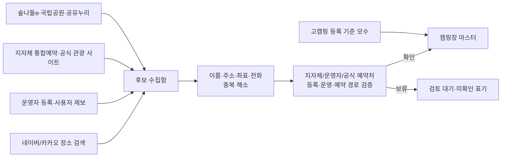

# 캠핑장 미디어·실시간 분위기·날씨·지도·주변 여행 연동 설계

> 확장 설계 기준일: 2026-10-13 (KST)<br>
> 연결 문서: [통합검색·예약 서비스 기획 및 설계](./캠핑장_통합검색_예약_서비스_기획_설계.md)

## 1. 목표와 비타협 원칙

캠핑장 상세 페이지는 단순 예약 카드가 아니라, 사용자가 **“지금 이곳에 가면 어떤 풍경이고, 무엇을 하고, 어떻게 가며, 실제로 예약 가능한가”**를 판단하는 여행 화면이어야 한다. 이를 위해 시설의 공식 정보, 최신 현장 콘텐츠, 날씨·이동, 인근 여행을 한 화면의 서로 다른 근거로 연결한다.

다만 ‘항상 최신인 모든 SNS 데이터’를 무단 수집해 보관하거나, 검색 결과를 캠핑장의 공식 사실처럼 쓰지 않는다. 플랫폼의 공식 API·임베드·운영자 연결·라이선스를 통해 접근한 자료만 사용하며, 각 카드에 원천·게시 시각·수집 시각·표시 만료를 표시한다. 최신 사진은 분위기 참고 자료이고, 사이트 크기·요금·반려동물 가능 여부 같은 운영 사실의 근거가 될 수 없다.

### 화면의 세 가지 정보 층

| 층 | 목적 | 허용 원천 | 사용자 표시 |
| --- | --- | --- | --- |
| **공식 시설 갤러리** | 사이트·객실·편의시설을 정확히 보여 줌 | 운영자 제공, 계약된 예약 채널, 고캠핑 API에서 허용되는 이미지 | `운영자/공식 사진`, 촬영 또는 갱신일, 저작권자 |
| **최근 현장 분위기** | 계절·날씨·혼잡도·현장 감각을 보조 | 운영자가 연결한 YouTube/Instagram/TikTok, 허용된 공식 검색 결과·임베드 | `최근 게시물`, 플랫폼, 게시 시각, 원문 열기 |
| **여행 판단 정보** | 가는 길·날씨·주변 활동을 계획 | 기상청, 지도·길찾기, 한국관광공사, 허용된 장소 검색 | `예보/경로 조회 시각`, 공급자, 추정값 여부 |

## 2. 사진과 영상: 풍성하지만 출처가 명확한 갤러리

### 2.1 미디어 우선순위와 권리

| 등급 | 원천 | 보관/표시 방식 | 용도 |
| --- | --- | --- | --- |
| A | 운영자 직접 업로드·라이선스 동의 | 원본, 리사이즈본, 대체텍스트, 촬영일, 철회 상태를 저장 | 대표 사진·상품·구역·사이트 갤러리 |
| A | 계약된 예약 엔진/공영 운영기관의 명시적 제공 | 계약 범위 안에서 URL 또는 복제본 사용 | 객실/상품 사진, 시설 안내 |
| B | 고캠핑 API/관광공사 콘텐츠의 명시된 이용 조건 | API 조건과 이미지별 권리 확인 후 사용 | 공공 기준 사진·관광 콘텐츠 |
| C | YouTube, Instagram, TikTok의 공식 임베드 | 미디어 파일을 복제하지 않고 해당 플랫폼 플레이어/임베드로 표시 | ‘최근 현장’ 피드 |
| D | 네이버·카카오 검색 결과 | 결과 제목·짧은 요약·출처 링크만, 각 약관의 표시/보존 조건을 준수 | 관련 콘텐츠를 찾는 탐색 탭 |

운영자와 계약된 공급자 외의 사진은 대표 배너나 예약 상품 사진으로 쓰지 않는다. 이용자 사진은 원본을 내려받아 재게시하지 않고, 공개 상태인 원문 임베드 또는 외부 링크로만 보여 준다. 삭제·비공개 전환·권리 철회가 감지되면 즉시 숨긴다.

### 2.2 미디어 데이터 모델

| 엔터티 | 핵심 필드 | 규칙 |
| --- | --- | --- |
| `media_asset` | 대상(`campground/zone/product`), URL/객체키, 가로·세로·비율, 촬영/게시일, `media_role`, alt, 출처 | 공식 이미지와 UGC를 같은 테이블에 섞지 않음 |
| `media_right` | 권리자, 라이선스/계약 ID, 사용 범위, 시작·종료·철회일 | 유효한 권리 레코드 없이는 CDN 복제 불가 |
| `social_connection` | 캠핑장, 플랫폼, 계정 ID/채널 ID, 소유 확인, OAuth 범위, 토큰 만료, 확인 원문 URL | 사업자만 자기 계정을 연결 가능 |
| `social_item` | 플랫폼 URL/외부 ID, 작성자, 게시시각, 관측시각, 임베드 허용 여부, 매칭근거, 삭제 확인시각 | 원문 미디어를 저장하지 않고 메타·임베드 참조 위주 |
| `content_match` | 후보 캠핑장, 점수, 이름/좌표/공식계정/해시태그 근거, 검토 상태 | 낮은 점수는 자동 노출하지 않음 |

`media_role`은 `HERO`, `SITE_DIMENSION`, `FACILITY`, `GLAMPING_INTERIOR`, `CARAVAN_INTERIOR`, `SEASON`, `ACTIVITY`, `ACCESS`, `SAFETY`, `RECENT_ATMOSPHERE`로 표준화한다. 각 상품에는 최소 `HERO` 1장, 사이트·객실에는 실제 상품을 식별할 수 있는 사진, 공용시설에는 별도 사진을 요구한다. 사진이 없으면 그럴듯한 다른 캠핑장 사진으로 빈 곳을 채우지 않는다.

### 2.3 상세 페이지의 시각 설계

1. **대표부:** 계절성을 반영한 공식 대표 이미지, 날짜별 예약 패널, 날씨·이동 요약을 함께 보여 준다.
2. **어떤 자리인가:** 사진 위에 `8×10m`, 바닥, 전기, 차량, 기준/최대 인원 같은 사이트 스펙을 붙인다. 사진과 수치의 출처가 같지 않으면 각각의 확인일을 표시한다.
3. **최근 현장:** 최근 30일/90일/전체 선택, 플랫폼별 필터, 원문에서 재생되는 영상/게시물, 게시 시각 순서. ‘공식 운영자’와 ‘방문자 공유’ 배지를 분리한다.
4. **계절 전환:** 봄·여름·가을·겨울 사진은 촬영 월을 기준으로 분류하고, 현재 달에 적합한 사진을 먼저 보여 준다. 사진의 촬영일이 없으면 계절 필터 대상에서 제외한다.
5. **접근성과 성능:** 3개의 반응형 이미지 크기, lazy loading, WebP/AVIF 파생본, 정확한 alt, 캡션·저작권 링크, 동영상 자동재생 금지.

## 3. SNS·블로그·영상 최신화: 플랫폼별 허용 범위

### 3.1 제공자별 어댑터

| 플랫폼 | 가능한 방식 | 최신화 설계 | 명확한 제한 |
| --- | --- | --- | --- |
| **YouTube** | Data API `search.list`, 공식 채널의 업로드 목록, 공식 IFrame 플레이어 | 공식 운영자 채널은 업로드 목록을 주기적으로 갱신. 일반 검색은 시설명·별칭·주소로 조회하고 `publishedAt` 최신순으로 제한 | 검색 결과는 오매칭 가능. 영상 저작권은 플랫폼 플레이어로만 재생하며, 공식 영상과 일반 영상을 구분 |
| **Instagram** | 캠핑장 운영자의 Professional 계정 연결, 허용된 공개 게시물의 공식 임베드, 앱 심사 후 허용되는 기능 | 사업자가 계정을 연결하면 해당 계정 콘텐츠를 갱신. 공개 해시태그/외부 사업자 탐색은 Meta 승인 범위에서만 사용 | 개인 계정·비공개 게시물·임의 전체 검색을 수집하지 않음. 임베드는 분석·재가공 데이터 원천이 아님 |
| **TikTok** | 운영자 또는 크리에이터의 Display API 권한 연결, `video.list` 결과와 공식 embed link | 권한을 준 계정의 최신 공개 영상만 갱신 | 임의의 해시태그/장소 전체를 검색하는 범용 수집기로 쓰지 않음. 계정 동의와 앱 승인 필요 |
| **네이버 블로그/카페/이미지/지역 검색** | Search API로 블로그·카페·이미지·지역 검색 결과 | 상세 페이지 요청 시 또는 짧은 TTL 내에서 새 질의. 캠핑장명 + 지역 + 별칭으로 별도 결과 탭 구성 | 제목·발행일·원문 링크 중심으로 독립 표시하고, 후기 이미지는 저장·상품 사진 사용 금지 |
| **다음/카카오 검색** | Daum Search API의 블로그·동영상·이미지·카페 결과 | 시설명·지역·별칭 질의, 최신순 결과와 원문 링크 표시 | 쿼터와 결과 저작권을 지키며, 검색 결과를 이미지 자산 저장소로 사용하지 않음 |
| **Facebook** | 운영자 Page 연결, Meta가 허용하는 Page/게시물 플러그인 또는 API | 연결된 Page의 게시 URL·시각을 갱신하고 원문·임베드로 표시 | 일반 사용자 게시물이나 무단 페이지 크롤링을 하지 않음 |
| **네이버 밴드** | 운영자가 직접 등록한 검증된 Band URL과 플랫폼이 허용하는 링크/임베드 | 계정 소유·캠핑장 매칭·표시 권한을 수동 검토 | 범용 Band 검색·이미지 수집기는 만들지 않음. API/임베드 조건이 확인될 때만 자동화 |

YouTube Data API는 검색어, 채널, 위치, 최신순 등을 지원한다. 다만 일반 검색은 색인 지연·오매칭이 있을 수 있으므로 ‘해당 캠핑장 관련 가능성’으로 표시하고, 사업자가 인증한 채널의 콘텐츠만 `공식` 배지를 받는다.

TikTok Display API는 인증한 사용자의 공개 영상 목록을 읽는 API다. 즉 “전국 모든 틱톡 게시물”의 수집 API가 아니다. 운영자 연결 흐름을 우선 제공하고, 방문자 게시물은 사용자가 공유한 공개 URL의 임베드만 검토 후 표시한다.

### 3.3 파일럿 확인 기록과 구현 순서

2026-10-13에 자라섬캠핑장 운영기관의 [시설 안내 페이지](https://www.gpfmc.or.kr/page/selectPage.do?muNo=649)에서 다음 운영기관 링크를 확인했다. `YouTube UCKaqqDletn_4jU8sGONDFkg`, `Instagram @gp_fmc`, `Facebook /gpfmc`이다. 이는 **운영기관 계정 링크가 확인된 상태**일 뿐, 개별 게시물이 자라섬캠핑장 현장을 나타낸다는 뜻은 아니다. 개별 `social_item`은 게시 URL·게시 시각·캠핑장 명칭/주소 매칭·표시 권한을 추가로 통과해야 한다.

1. 운영자가 공식 채널을 연결하면 `social_connection`에 계정 식별자, 연결 동의, 원문 근거, 권한 만료를 저장한다.
2. YouTube는 인증 채널의 업로드 목록을 우선 읽고, 일반 검색은 보조 결과로 분리한다. 업로드 순서는 `playlistItems.list`를 우선한다.
3. Instagram/Facebook은 Meta가 허용한 OAuth·oEmbed/플러그인 범위에서만 원문을 표시한다.
4. TikTok은 승인된 Display API의 `video.list` 또는 개별 공식 embed URL만 쓴다.
5. 네이버 블로그·카페는 [검색 API](https://developers.naver.com/docs/serviceapi/search/cafearticle/cafearticle.md)의 최신순 결과에서 제목·발행일·원문 링크만 단기 캐시한다.
6. 밴드는 운영자 등록 URL을 검토 큐에 넣고, 플랫폼의 공식 표시 방법이 확인된 항목만 연결한다.

모든 최근 현장 카드는 `platform`, `account_verification`, `source_url`, `published_at`, `observed_at`, `match_confidence`, `embed_allowed`, `deletion_checked_at`을 반환해야 한다. 이 중 하나라도 없으면 대표 사진 또는 예약 판단의 근거로 노출하지 않는다.

### 3.2 콘텐츠 매칭·안전 검토

게시물을 자동으로 특정 캠핑장에 귀속시키기 전에 아래 조건을 평가한다.

| 강한 근거 | 보조 근거 | 자동 노출 여부 |
| --- | --- | --- |
| 연결된 공식 계정/채널 | 없음 | 즉시 `공식` 노출 |
| 정확한 시설 고유명 + 도로명 또는 공식 해시태그 | 좌표가 캠핑장 반경 안 | `방문자 공유` 노출 가능 |
| 이름만 일치 | 지역명·사진 문맥 일부 일치 | 검토 큐로 이동 |
| 유사명/다른 지역/광고성 반복 | 없음 | 노출하지 않음 |

- 콘텐츠에는 `게시 시각`, `가져온 시각`, `원천 URL`, `매칭 근거`, `신고` 버튼을 표시한다.
- 시설 규칙·가격·위생·안전·혼잡 여부는 SNS 문구에서 추출해 자동 확정하지 않는다.
- 아동 얼굴, 사생활 침해, 혐오/성적/위험 행동, 무단 광고, 허위 예약 링크를 탐지·신고·검토하는 운영 큐를 둔다.
- 게시물이 삭제되거나 임베드 오류가 나면 보관 카드를 남기지 않고 원문 참조를 제거한다.

## 4. 날씨와 안전 정보

### 4.1 원천과 화면

기상청 API허브의 관측·예특보 데이터를 기본 원천으로 쓴다. API허브는 초단기·단기·중기예보와 폭염·한파·호우 등 11종 특보를 제공하며, API 키 발급·호출 한도가 적용된다. 캠핑장 좌표를 예보 격자/가까운 관측 지점에 매핑해 다음을 제공한다.

| 화면 | 데이터 | 표시 방법 |
| --- | --- | --- |
| 현재 현장 | 가장 가까운 관측/초단기 실황 | 관측 지점·관측시각·거리 표시 |
| 체크인 시간대 | 단기예보의 기온·강수확률/량·풍속·풍향·적설·습도 | 시간대별 타임라인, 발표시각 표시 |
| 여행 기간 | 단기/중기예보 | 날짜별 요약과 예보 신뢰 범위 고지 |
| 안전 알림 | 기상특보, 태풍·호우·강풍 등 | 캠핑장 공지와 분리된 빨간 안전 배너, 발효시각·공식 링크 |
| 준비물 제안 | 예보에서 파생한 규칙 | “강수 가능성 — 방수 장비 확인”처럼 조언으로만 표기 |

날씨 캐시는 예보 발표 시각과 원천 응답의 유효 범위에 맞춰 갱신한다. 화면의 새로고침마다 원천을 과도하게 호출하지 않으며, 오래된 예보를 현재 날씨로 표시하지 않는다. 위험 판단은 기상청 특보를 그대로 우선 표시하고, 자체 점수는 ‘준비 참고’ 수준으로 한정한다.

### 4.2 날씨 스키마

`weather_grid_mapping(campground_id, grid_x, grid_y, station_id, mapping_method, verified_at)`<br>
`weather_snapshot(campground_id, observed_at, issued_at, valid_from, valid_to, source, payload_hash)`<br>
`weather_alert(campground_id, alert_type, level, issued_at, valid_from, valid_to, official_url, state)`

## 5. 내 위치·지도·거리·톨게이트 비용

### 5.1 개인정보와 지도 제공자

현재 위치는 사용자가 명시적으로 ‘내 위치 사용’을 누른 뒤 브라우저의 위치 권한을 허용한 경우에만 읽는다. 기본값은 출발지 미입력 상태이며, 사용자가 검색한 출발지 또는 현재 위치는 경로 조회 후 영속 저장하지 않는다. 즐겨찾는 출발지 저장은 별도 동의·삭제 기능을 둔다.

지도 타일과 길찾기 응답에는 제공자별 라이선스·표시 의무가 있다. 지도 공급자를 도메인별로 무단 혼합하지 않고, 아래 어댑터로 분리한다.

| 기능 | 1차 선택 | 대안/보완 | 사용자 표시 |
| --- | --- | --- | --- |
| 캠핑장 지도·핀 | 계약된 NAVER Maps 또는 Kakao Map SDK 중 하나 | 공급자 공식 외부 지도 열기 | 지도 저작권·로고·공급자명 |
| 자동차 거리·실시간 교통·톨비 | NAVER Cloud Maps Directions 5 | Kakao Mobility 길찾기 계약 API | 거리, 예상 소요, **조회 시점**, 차량종류, 톨비/연료비는 예상치 |
| 대중교통·도보·자전거 | Kakao Map REST | 해당 제공자의 외부 길찾기 딥링크 | 환승/도보/요금/조회 시각 |
| 내비게이션 시작 | Naver Map/Kakao Navi 공식 딥링크 | 앱 미설치 시 웹 길찾기 | 사용자가 선택한 앱에서 최종 경로 확인 |

NAVER Directions 5의 자동차 경로 응답에는 실시간 교통 기반 거리·소요 시간과 `tollFare`, 예상 연료비가 포함된다. 같은 출발지와 목적지도 교통 상황에 따라 달라지므로 결과에는 반드시 조회시각과 ‘예상’임을 적는다. 카카오 길찾기는 차량·연료·하이패스 옵션을 포함한 별도 Kakao Mobility API 계약 대상으로 관리한다.

### 5.2 경로 견적 스키마

```json
{
  "origin": {"kind": "browser_location", "lat": 37.5, "lng": 127.0},
  "destination_campground_id": "camp_…",
  "vehicle": {"class": "PASSENGER_CAR", "fuel": "GASOLINE", "mileage_km_per_l": 14},
  "route": {
    "provider": "NAVER_DIRECTIONS_5",
    "queried_at": "2026-10-12T11:00:00+09:00",
    "distance_m": 123456,
    "duration_s": 7200,
    "toll_krw": 6500,
    "estimated_fuel_krw": 18400,
    "is_estimate": true
  }
}
```

경로 견적은 계정에 저장할 필요가 없는 단기 데이터다. 분석에는 세부 좌표 대신 도/시군구 수준으로 비식별 집계하며, 사용자가 예약을 확정해도 현재 위치 원본을 예약 정보에 자동 복사하지 않는다.

## 6. 인근 관광·맛집·활동 추천

### 6.1 추천 원천과 순서

| 종류 | 1차 원천 | 보조 원천 | 추천 기준 |
| --- | --- | --- | --- |
| 관광지·문화·축제·레저 | 한국관광공사 TourAPI/관광콘텐츠 | 지자체 공식 관광 사이트 | 캠핑장과의 거리·운영일·계절·이용자 선택 테마 |
| 산책·트레킹·자연 | 두루누비/공식 공원·지자체 | TourAPI | 난이도, 이동 시간, 반려동물/유아 동반 조건 |
| 식당·카페·마트·약국·주유소 | Kakao Local 카테고리/키워드 검색 | 네이버 지역 검색, 운영자 큐레이션 | 반경·차량 이동 시간·카테고리·공식 영업 정보 검증 |
| 캠핑 준비·긴급 | 공공기관/공식 장소 | 지도 제공자 검색 | 병원·약국·마트·주유·정비·덤프스테이션을 목적별 분리 |

관광 추천은 “인근 인기순” 하나로 고정하지 않는다. 사용자가 `아이 동반`, `반려견`, `비 오는 날`, `차량 30분 이내`, `물놀이`, `시장/맛집`, `트레킹`을 고르면 해당 조건을 만족하는 후보만 재정렬한다. 영업시간·휴무·입장료가 공식으로 확인되지 않으면 “방문 전 확인”을 표기한다.

Kakao Local은 중심 좌표·반경·카테고리로 장소를 조회하고 거리와 지도 상세 URL을 제공하므로 인근 편의시설에 적합하다. 네이버 지역 검색도 업체명·주소·분류·좌표를 제공한다. 두 검색 결과는 사업장 동일성 검증을 거쳐 표시하며, 리뷰 수나 검색 순위만으로 ‘맛집’을 단정하지 않는다.

### 6.2 여행 추천 UI

- 상세 페이지에는 `캠핑장 → 추천 장소`의 실제 운전 시간으로 정렬한 카드 6개를 먼저 노출한다.
- “하루 코스 만들기”는 캠핑장 체크인/아웃 시간, 선택 장소의 운영시간, 운전 시간, 사용자의 최대 이동 시간을 제약으로 계산한다.
- 코스는 확정된 예약이 아니라 제안이다. 장소마다 원천, 조회 시각, 외부 지도 열기를 제공한다.
- 우천·특보가 있으면 야외 코스는 낮추고 실내/취소 가능 코스를 우선 제안하되, 추천 이유를 드러낸다.

## 7. 파편화된 예약처와 숨은 캠핑장 발견

### 7.1 예약 공급자 레지스트리

예약처를 단순 URL 목록이 아닌 관리 가능한 공급자로 등록한다.

| 필드 | 설명 |
| --- | --- |
| `provider_id`, `provider_name`, `provider_type` | 숲나들e, 국립공원, 공유누리, 지자체 통합예약, 개별 운영자, OTA/티켓 플랫폼 등 |
| `integration_mode` | `OFFICIAL_REDIRECT`, `PUBLIC_READ_API`, `CONTRACT_API`, `OPERATOR_PORTAL`, `MANUAL_VERIFIED` |
| `booking_capability` | 상품·재고·가격·예약창·추첨·취소 중 실제로 읽을 수 있는 범위 |
| `terms_reviewed_at`, `rate_limit`, `contract_status` | 약관/쿼터/제휴 상태 |
| `last_success_at`, `freshness_sla`, `incident_state` | 예약 가능 표시에 필요한 운영 상태 |
| `site_mapping` | 외부 시설/구역/상품 ID와 우리 `campground/zone/product` 연결 |

인터파크를 포함한 OTA·티켓 플랫폼은 ‘이름이 알려졌기 때문’에 전체 재고를 자동 수집 대상으로 삼지 않는다. 캠핑장별 실제 판매 URL과 공급자·상품 ID를 확인하고, 공식 공개 API 또는 계약 피드가 있는 범위에서만 재고/가격을 읽는다. API가 없는 경우에는 정확한 공식 링크·예약 방법·오픈 일정을 검증해 `외부 예약`으로 제공한다.

### 7.2 숨은 명소/누락 시설 후보 파이프라인



검색·SNS·블로그는 숨은 후보를 발견하는 **단서**로만 쓴다. 다음 중 하나가 검증되어야 검색에 정식 등록한다.

1. 고캠핑 또는 지자체의 등록/운영 원천과 동일성 확인
2. 운영 주체가 공식 도메인·전화·사업자/관리 증빙으로 직접 등록하고 검토 통과
3. 공공기관이 운영하는 시설임을 공식 공고·예약 페이지에서 확인

후보 단계에서는 `미확인 후보`로 관리자만 볼 수 있게 하며, 일반 사용자에게 예약 가능한 캠핑장처럼 노출하지 않는다. 폐업·휴장·명칭 변경도 같은 파이프라인으로 관리한다.

## 8. 최신화와 품질 운영

| 데이터 | 갱신 트리거 | 사용자에게 보이는 신선도 | 만료 시 처리 |
| --- | --- | --- | --- |
| 공식 시설/상품 정보 | 운영자 변경, 기준 API 증분, 검토 완료 | 최종 확인일 | 기존값은 이력 보관, 핵심 충돌은 검증 필요 |
| 공식 SNS 계정 콘텐츠 | 연결 계정 동기화/webhook가 허용되는 경우 | 게시시각·동기화시각 | 삭제/권한 만료 시 즉시 비노출 |
| 검색 기반 콘텐츠 | 사용자 요청·짧은 캐시·공급자 허용 범위 | 검색 시각 | 약관상 보존기한 전 삭제, 영구 추천 학습에 사용하지 않음 |
| 날씨·특보 | 예보 발표/특보 변동 | 발표·관측·발효 시각 | 현재 상태로 표시 금지 |
| 자동차 경로·톨비 | 사용자가 출발지와 차량으로 조회 | 조회 시각 | 재조회 전에는 ‘예상 경로’로 재사용하지 않음 |
| 주변 장소 | 사용자 요청 또는 제한된 캐시 | 조회 시각·공급자 | 영업 상태 미검증이면 확인 안내 |

운영 대시보드에는 `외부 API 성공률`, `콘텐츠 오매칭 신고율`, `권리 철회 처리 시간`, `날씨/특보 지연`, `경로 견적 오류`, `공급자별 예약 링크 실패율`, `후보→검증 전환율`을 둔다. 데이터가 오래되었을수록 결과를 더 많이 보여 주는 방식이 아니라, 더 명확하게 ‘갱신 필요’로 낮춘다.

## 9. 추가 API와 DB 계약

```http
GET /v1/campgrounds/{id}/media?scope=OFFICIAL|RECENT&platform=youtube
GET /v1/campgrounds/{id}/weather?check_in=2026-10-17&check_out=2026-10-18
POST /v1/routes/quote
GET /v1/campgrounds/{id}/nearby?theme=FAMILY&max_drive_minutes=30
GET /v1/campgrounds/{id}/content?source=naver&sort=RECENCY
GET /v1/campgrounds/{id}/booking-channels
POST /v1/operator/campgrounds/{id}/social-connections
```

`POST /v1/routes/quote`는 위치·차량·출발 시각을 요청에서만 쓰고, 기본적으로 DB에 원본 위치를 저장하지 않는다. `content` 응답은 `official`, `visitor_shared`, `search_result`의 타입을 반드시 반환하며, `search_result`는 플랫폼별 보존·표시 정책을 적용한 뒤에만 응답한다.

## 10. 구현 순서와 수락 기준

1. **공식 미디어/시설:** 운영자 갤러리, 권리 동의, 고캠핑 기반 사진·스펙, 상품별 사진 누락 알림.
2. **날씨·지도:** 기상청 키, 예보 격자 매핑, 지도 SDK 한 곳 선택, NAVER Directions 5 자동차 견적과 카카오 대중교통/주변 장소 연결.
3. **관광·주변:** TourAPI와 Kakao Local을 이용한 반경·이동시간 기반 카드, 원천·확인시각 노출.
4. **공식 소셜 연결:** 사업자용 YouTube/Instagram/TikTok 연결 콘솔과 권한 만료·삭제 처리.
5. **검색 콘텐츠:** 네이버/다음 검색 결과를 독립 탭에서만 표시하고, 각 플랫폼 약관에 맞춘 캐시·출처 표기 검증.
6. **후보 발견/예약처 레지스트리:** 공영·지자체·개별 운영자·OTA 예약처를 후보→동일성→검증 순서로 등록.

수락 기준은 ‘사진과 카드가 많이 보인다’가 아니다. 대표 상품 사진의 권리/출처가 100% 있고, 최신 콘텐츠는 플랫폼·게시시각·원문 링크를 갖고, 현재 위치는 동의 없이 저장되지 않으며, 날씨·톨비·예약 가능은 모두 조회 시각과 원천을 보여 주어야 한다.

## 11. 공식 기술 근거

- [NAVER Cloud Maps Directions 5](https://api.ncloud-docs.com/docs/application-maps-directions5): 실시간 교통 기반 거리·소요시간·통행료(`tollFare`)·예상 연료비.
- [Kakao Map REST API](https://developers.kakao.com/docs/ko/kakaomap/rest-api): 대중교통·도보 경로와 지도 기능.
- [Kakao Local API](https://developers.kakao.com/docs/ko/local/dev-guide): 좌표·반경·카테고리 기반 주변 장소와 거리.
- [기상청 API허브](https://apihub.kma.go.kr/apiInfo.do): 관측·예보·기상특보 API와 인증키/호출 정책.
- [한국관광공사 관광콘텐츠 API](https://api.visitkorea.or.kr/): 위치·지역 기반 관광·음식·여행 콘텐츠.
- [NAVER 검색 API — 블로그](https://developers.naver.com/docs/serviceapi/search/blog/blog.md) / [지역](https://developers.naver.com/docs/serviceapi/search/local/local.md): 블로그·지역 검색 결과와 공식 호출 조건.
- [NAVER 검색 API 이용약관 변경 안내](https://developers.naver.com/notice/article/33400): 검색 결과의 독립 표시와 보관·재사용 제한을 반드시 구현 전 재확인.
- [Kakao Daum Search](https://developers.kakao.com/docs/ko/daum-search/common): 웹·블로그·카페·이미지·동영상 검색과 쿼터.
- [YouTube Data API Search](https://developers.google.com/youtube/v3/docs/search/list): 공개 영상·채널 검색, 위치/최신순 필터와 쿼터.
- [YouTube Data API PlaylistItems](https://developers.google.com/youtube/v3/docs/playlistItems/list): 인증·공식 채널의 최신 업로드 목록을 읽는 우선 경로.
- [TikTok Display API](https://developers.tiktok.com/doc/display-api-get-started): 사용자 권한을 받은 계정의 공개 프로필·최근 영상 표시.
- [Instagram Platform oEmbed](https://developers.facebook.com/docs/instagram-platform/oembed): 공개 게시물의 플랫폼 임베드. Meta 앱 심사·Professional 계정·권한 요건은 출시 직전에 최신 문서로 재검증.
