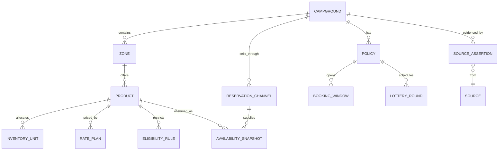
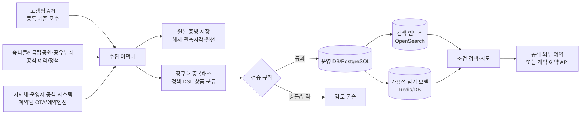

# 전국 캠핑장 통합검색·예약 서비스 — 기획 및 설계 초안

> 조사 기준일: 2026-10-12 (KST)<br>
> 목표: 전국의 **등록 야영장**을 빠짐없이 발견하게 하고, 사이트·상품 단위의 조건과 가격을 비교하며, 해당 날짜에 실제 예약할 수 있는 상품만 명확한 근거와 함께 보여 주는 서비스.

미디어, SNS, 날씨, 지도, 주변 관광과 분산 예약처에 대한 확장 설계는 [캠핑장 미디어·지도·투어 연동 설계](./캠핑장_미디어_지도_투어_연동_설계.md)를 따른다.

## 1. 먼저 확정할 서비스 원칙

이 서비스의 핵심은 ‘캠핑장 목록’이 아니라 **날짜·인원·차량·상품 조건을 만족하는 판매 가능 재고**다. 따라서 한 캠핑장을 하나의 레코드로만 저장하면 안 된다. 같은 캠핑장 안에서도 A존/글램핑/카라반/캠프닉은 가격, 정원, 입퇴실 시간, 예약 창, 환불 규정과 재고가 모두 다를 수 있다.

전국 등록 야영장의 기준 모수는 한국관광공사 고캠핑(OpenAPI)으로 시작한다. 2026-10-12 기준 고캠핑 지도 검색은 4,677개를 노출하며, API는 지자체 인허가 시스템에 등록된 야영장의 운영 현황, 위치, 편의·안전 시설을 제공한다. 이 데이터는 전국 발견성과 법정 등록 여부의 기준으로 쓴다. 개별 시설의 실제 판매재고와 확정 요금은 고캠핑의 원천이 아니므로, 반드시 공식 예약 시스템 또는 계약된 공급자 피드로 확인한다.

‘전국 모든 캠핑장’이라는 표현은 다음처럼 제품에 표시한다.

| 범위 배지 | 포함 기준 | 사용자에게 하는 약속 |
| --- | --- | --- |
| `등록 확인` | 고캠핑/지자체 등록 원천에 존재하고 최근 동기화 성공 | 관광진흥법상 등록 정보를 기준으로 발견 가능 |
| `운영 확인` | 운영자 또는 공식 예약 원천이 최근 N일 안에 확인됨 | 현재 운영 정보가 있음 |
| `예약 연동` | 공식 API/계약 피드/검증된 예약 엔진 연동 | 날짜별 재고·가격을 조회할 수 있음 |
| `즉시 예약` | 우리 서비스에서 재고 잠금·결제·확정까지 계약상 처리 가능 | 이 서비스 안에서 예약이 확정됨 |
| `외부 예약` | 공식 판매처로 날짜/상품을 넘김 | 최종 예약은 판매처에서 완료해야 함 |

미등록, 신규 개장, 휴·폐업 직후의 시설은 공공 기준 모수만으로 완전성을 보장할 수 없다. 이들은 사업자 자가 등록과 지자체 확인을 거친 뒤 `등록 대기`/`검증 중`으로 분리한다. 추정값을 사실처럼 표시하지 않는다.

## 2. 조사 결과: 우선 데이터 원천과 수집 방식

### 2.1 1차 원천: 전국 단위 기준 데이터

| 원천 | 신뢰도 역할 | 얻을 수 있는 값 | 수집 방식 | 한계 |
| --- | --- | --- | --- | --- |
| [한국관광공사 고캠핑 정보 조회 API](https://www.data.go.kr/data/15101933/openapi.do) | 등록 야영장 기준 원천 | 캠핑장 식별값, 명칭, 주소·좌표, 일반/자동차야영장, 운영기간·일, 시설·안전정보, 이미지 | `basedList` 전체 적재 후 `basedSyncList` 증분 동기화 | 실시간 예약 재고·세부 상품별 가격은 기준 원천이 아님 |
| [고캠핑 상세 페이지](https://www.gocamping.or.kr/) | API 값 교차검증·보강 | 사이트 면수·크기·간격, 바닥, 장비대여, 반려동물, 화로대, 가격 범위, 예약 URL | API와 일치하는 `contentId` 기준 검증, 변경일 저장 | 고캠핑도 현장 상황과 다를 수 있다고 고지함. 웹 저작물은 API 이용 조건과 별도 검토 |
| 지자체 인허가/공공시설 데이터 | 등록상태 보강 | 운영 주체, 공영 여부, 휴장·공사 공지, 지역 감면 | 기관별 API·공고·제휴 | 포맷과 갱신 주기가 제각각 |
| [공유누리](https://www.eshare.go.kr/UserPortal/Upc/54/contents.do) 및 OpenAPI | 공공자원 후보·예약 경로 | 공공 시설, 기관, 예약/외부 이동 여부 | 기관 정보와 자원 API 신청 후 적재 | API는 심의 승인(공식 안내상 약 3~5일)이며, 모든 야영장 재고를 뜻하지 않음 |

고캠핑은 실제로 일반·자동차야영장, 입지, 바닥, 전기·온수·덤프스테이션, 캠핑카/트레일러/반려동물 등의 검색 필터를 제공한다. 상세 시설의 예로 사이트 면수, 면별 크기, 간격, 바닥, 소화기와 화재감지기까지 노출된다. 따라서 정적 시설 검색의 출발점으로 적합하다.

### 2.2 1차 원천: 예약·정책 군집

| 예약 군집 | 공식 원천 | 공통화 가능한 것 | 반드시 시설/상품별로 보존할 것 |
| --- | --- | --- | --- |
| **숲나들e** (국립·공립·사립 자연휴양림) | [숲나들e FAQ/예약안내](https://www.foresttrip.go.kr/pot/cc/fa/selectFaqBbrssListView.do?bbrssMsterId=BBRSSMSTER_00000002&ctgryCd=&hmpgId=FRIP&nowPage=1&srwrd=%EC%A3%BC%EC%A4%91&twbbsId=) | 예약 화면 흐름, 일반/우선/추첨이라는 정책 유형, 자연휴양림 식별 | 시설별 적용 여부, 대상 사이트, 시즌, 오픈·마감시각, 결제기한, 감면, 취소 규정 |
| **국립공원공단 예약시스템** | [국립공원공단 예약시스템](https://res.knps.or.kr/) | 야영장·추첨·정책 페이지·예약 경로 | 공원·야영장·구역별 재고, 추첨 회차, 가격, 결제 및 휴장 공지 |
| **공유누리/지자체 통합예약** | [공공자원 예약 안내](https://www.eshare.go.kr/UserPortal/Upc/56/contents.do) | 직접 예약/기관 예약 이동이라는 채널 분류 | 각 지자체의 상품, 감면, 시민 조건, 선착순·추첨, 실제 판매 시각 |
| **개별 공영 캠핑장** | 운영 지자체 또는 시설 공식 홈페이지 | 운영자·공영 여부·지역 할인의 검증 | 고유 예약 엔진, 단체/성수기/공사 정책, 구역별 상품 |
| **민간 캠핑장** | 사업자 공식 홈페이지·공식 예약 페이지·사업자 관리자 연동 | 운영자 인증과 상품 표준화 | 사업자의 요금·재고·옵션·환불·현장 규칙, 외부 판매 채널 |
| **계약된 OTA/예약 엔진** | 계약 API, webhook, 정산 명세 | 공통 재고/요금/예약 어댑터 | 계약 범위, 재고 소유권, 취소·환불 책임, 채널별 판매가 |

숲나들e를 하나의 ‘공통 예약 규칙’으로 과도하게 일반화하면 안 된다. 공식 안내상 국립 46개 휴양림에 적용되는 비수기 주중 선착순은 사용일 6주 전 수요일 09:00부터이고, 비수기 주말은 매월 신청·추첨·미결제분 전환 절차가 있다. 그러나 같은 포털 안에서도 국·공·사 및 개별 시설의 위약금·감면은 다를 수 있다고 명시한다. 따라서 기본 템플릿을 재사용하되 `policy_override`가 언제나 템플릿보다 우선하도록 모델링한다.

공유누리도 한 가지 예약 방식이 아니다. 공식 가이드가 말하듯 공유누리에서 직접 신청하는 자원도 있고, 지자체/기관 시스템으로 이동해 신청하는 자원도 있다. 따라서 `reservation_channel`은 포털 이름이 아니라 `DIRECT_API`, `DIRECT_WEB`, `OFFICIAL_REDIRECT`, `PHONE`, `ON_SITE`, `LOTTERY_APPLICATION`처럼 행동 기준으로 저장한다.

### 2.3 예약 가능 여부를 “실시간”으로 말할 수 있는 조건

다음 상태를 UI와 API 모두에서 구분한다.

| 표시 상태 | 충족 조건 | 노출 문구 예시 |
| --- | --- | --- |
| `LIVE_AVAILABLE` | 계약 API 또는 공식 예약 화면의 상품·날짜·인원 검증을 방금 통과했고, 유효기간 안임 | “예약 가능 · 2분 전 확인” |
| `LIVE_SOLD_OUT` | 같은 방식으로 매진을 확인 | “현재 매진 · 2분 전 확인” |
| `OPEN_SCHEDULED` | 판매창은 아직 열리지 않았고, 공식 정책 또는 시설 공지로 일정 확인 | “11월 4일 09:00부터 신청” |
| `LOTTERY_OPEN` | 공식 추첨 접수기간과 자격이 일치 | “추첨 신청 가능 · 조건 확인” |
| `OFFICIAL_CHECK_REQUIRED` | 공식 판매처는 확인했지만 기계 판독 가능한 재고가 없음 | “공식 예약처에서 최종 확인 필요” |
| `STALE` | 유효기간이 지났거나 오류·정책변경 신호가 있음 | “정보 갱신 중 — 예약 가능 여부를 단정하지 않음” |

`LIVE_AVAILABLE`만 ‘이번 주말 예약 가능’ 필터에 포함한다. 판매창 오픈 전이거나 오래된 크롤링 결과는 검색 결과에는 남겨도 그 필터의 참으로 만들지 않는다. 인기 캠핑장은 재고 변동이 매우 빠르므로 화면에 `관측시각`, `원천`, `재확인` 버튼을 항상 둔다.

## 3. 분류 체계: 법정 업종, 시설, 판매 상품을 분리

관광진흥법상 야영장업의 법정 유형은 일반야영장업과 자동차야영장업이다. 사용자가 찾는 글램핑·카라반·캠프닉·타프존은 이 법정 구분과 다른 **판매 상품 또는 구역 특성**이다. 한 필드에 섞으면 정확한 검색과 통계가 불가능하므로 아래 4층 분류를 쓴다.

| 층 | 필드 예시 | 표준값 | 설명 |
| --- | --- | --- | --- |
| 법정·운영 분류 | `legal_business_type`, `operator_type` | 일반야영장, 자동차야영장 / 국립·지자체·공공기관·민간 | 등록과 운영 주체를 설명 |
| 장소/구역 | `zone_type`, `site_surface`, `site_dimensions` | 오토존, 노지, 데크존, 타프존, 쉘터존 / 파쇄석·잔디·데크 | 실제 자리와 환경을 설명 |
| 판매 상품 | `product_kind`, `stay_mode` | 텐트사이트, 오토사이트, 텐트대여, 글램핑, 카라반, 캠프닉, 패키지 / 숙박·당일 | 날짜·재고·가격이 걸리는 단위 |
| 기능·제약 | `amenities`, `policies`, `eligibility` | 전기, 온수, 반려견, 화로대, 차량, 인원, 감면, 추첨 | 필터·요금·예약 자격 계산 |

권장 `product_kind` 사전:

| 사용자 표기 | 코드 | 필수 속성 |
| --- | --- | --- |
| 일반 캠핑/노지 | `PITCH` | 텐트 직접 설치 여부, 사이트 면적/폭/깊이, 바닥, 차량 진입, 정원 |
| 오토캠핑 | `AUTO_PITCH` | 차량 옆 설치, 주차 포함 수, 차량 규격·추가차량 요금, 전기 |
| 타프존 | `TARP_ZONE` | 상부 타프 제공 여부·크기, 텐트 필요 여부, 사이트 치수 |
| 쉘터존 | `SHELTER_ZONE` | 쉘터 유형/폐쇄 가능 여부, 냉난방 여부, 비품·텐트 필요 여부 |
| 텐트 대여/세팅 | `RENTAL_TENT` | 제공 텐트 모델, 침구·취사도구·전기 포함 여부, 정원 |
| 글램핑 | `GLAMPING` | 고정형 숙박 텐트, 침구/욕실/냉난방/취사, 기준·최대 인원 |
| 카라반 | `CARAVAN_RENTAL` | 대여 카라반, 면적/침실/욕실/취사, 기준·최대 인원 |
| 캠퍼밴·RV 자리 | `RV_PITCH` | 덤프·급수·전력 규격, 차량 길이/높이, 견인차 분리 여부 |
| 캠프닉 | `CAMPNIC_DAY` | 당일 이용 시간대, 제공 장비, 숙박 불가, 인원 단가/좌석 |
| 부대 상품 | `ADD_ON` | 숯·장작·전기·추가인원·추가차량·체험 등의 과금·재고 |

`글램핑`, `카라반`, `타프존`, `쉘터존`이라는 문구만으로 제공 물품을 추론하지 않는다. 각 상품에 `included_items`, `required_to_bring`, `bathroom_scope`, `heating_cooling`, `check_in/out`을 명시한다. 사이트 크기는 문자열이 아닌 `width_m`, `depth_m`, `area_m2`, `measurement_source`, `applies_to`로 보존한다. 예컨대 고캠핑이 “8×10 38개, 12×12 5개”를 제공하면 **구역/사이트유형별** 치수와 수량으로 적재하며, 전체 캠핑장 평균값으로 바꾸지 않는다.

## 4. 데이터 모델

### 4.1 핵심 엔터티와 관계



### 4.2 테이블별 최소 컬럼

구현 가능한 PostgreSQL 초안은 [초기 데이터베이스 스키마](../db/001_initial_schema.sql)에 작성했다. 해당 스키마는 원천 증빙과 가용성 이력을 별도 테이블로 두며, 외부 공급자 값을 운영 데이터에 덮어쓰지 않는다.

| 테이블 | 대표 컬럼 | 설계 이유 |
| --- | --- | --- |
| `campground` | UUID, 고캠핑 ID, 법정명/표기명, 주소·좌표, 등록/운영 상태, 운영 주체, 공식 URL | 전국 기준 모수와 동일성 관리 |
| `zone` | 캠핑장 ID, 구역명, 차량 진입, 사이트 간격, 바닥, 공용 시설 거리/범위 | 같은 캠핑장의 서로 다른 환경 구분 |
| `product` | 구역 ID, 상품명, `product_kind`, 숙박/당일, 기본/최대 인원, 반려동물/차량, 체크인·아웃 | 사용자가 실제 구매하는 단위 |
| `inventory_unit` | 상품 ID, 자리/객실 코드, 폭·깊이·면적, 면수, 상태 | 사이트 크기와 특정 자리 판매를 정확히 연결 |
| `rate_plan` | 상품 ID, 날짜/요일/성수기 규칙, 기본가, 세금, 인원/차량/전기/옵션 과금, 통화 | ‘최저가’가 아닌 선택 조건의 총액 계산 |
| `availability_snapshot` | 상품/재고단위, 날짜, 인원·차량 조건, 상태, 잔여 수, 조회 시각, 만료 시각, 원천 | 예약 가능이라는 주장의 근거와 신선도 |
| `reservation_channel` | 공식/계약 여부, URL, 연동 유형, 외부 ID, 인증 방식, 마지막 성공 시각 | 판매처를 하나 이상 가질 수 있음 |
| `policy` | 취소·환불, 할인, 입실 규칙, 반려동물, 우천·휴장, 노쇼, 증빙 필요 | 텍스트를 구조화하고 원문도 보관 |
| `booking_window` | 대상 상품/정책, 판매·신청·발표·결제 시작/종료, timezone, 근거 URL | 선착순 오픈 알림과 캘린더 |
| `lottery_round` | 회차, 대상일, 신청 기간, 발표/결제 기간, 자격, 중복 제한 | 추첨을 ‘매진’과 구분 |
| `source` / `source_assertion` | URL/API 요청, 원문 해시, 관측시각, 필드명, 원값, 정규화값, 신뢰등급, 검토상태 | 필드별 출처·재현·감사 |

**중요 제약**

1. 금액은 `KRW 정수`, 세금포함 여부, 1박/1회/1인/차량/옵션 단위를 반드시 분리한다.
2. 기준 인원과 최대 인원, 성인·아동·유아의 나이 기준, 추가 인원 불가 여부를 서로 다른 필드로 둔다.
3. `availability_snapshot`은 현재 재고를 덮어쓰지 않는다. 이력과 원천 응답 해시를 유지하고, 최신 유효 스냅샷만 조회 인덱스에 투영한다.
4. 모든 일정은 `Asia/Seoul`과 원천 표기 시간을 함께 저장한다. “매월 4일 09:00”처럼 규칙인 경우에는 iCalendar RRULE로 단순 환원하지 말고 정책 DSL과 원문을 함께 저장한다.
5. 원문 HTML/PDF/응답은 접근 권한과 보존 기간을 정해 증빙 저장소에 두되, 이용약관이 허용하지 않는 콘텐츠 복제·재배포는 하지 않는다.

### 4.3 중복 제거와 동일성

같은 시설은 고캠핑, 지자체, 숲나들e, 지도·OTA에서 다른 이름과 주소로 나타난다. 자동 병합은 다음 순서로 하되, 충돌은 사람 검토 큐로 보낸다.

1. 고캠핑 ID나 계약된 운영자 ID처럼 **영속적인 외부 키**가 일치하면 병합한다.
2. 주소를 법정동·도로명 좌표로 정규화하고, 이름·전화·좌표·운영자명을 함께 점수화한다.
3. 서로 다른 캠핑장으로 보이는 두 시설이 같은 대표 전화·좌표를 가질 때도 자동 병합하지 않는다. 동일 부지의 캠핑장/글램핑장 분리 운영일 수 있다.
4. 별칭은 `campground_alias`로 남기고, 원래 명칭과 원천을 보존한다.

## 5. 신뢰도·교차검증 정책

각 필드는 ‘신뢰 점수 하나’가 아니라 **원천, 관측시각, 검증상태, 표시 가능 여부**를 가진다.

| 우선순위 | 원천 | 사용할 수 있는 사실 | 기본 처리 |
| --- | --- | --- | --- |
| A | 공공 등록 API, 운영 기관의 공식 예약 API, 계약된 운영자 재고 피드 | 등록 상태, 공식 판매 가격·재고·정책 | 즉시 반영. 예약값은 짧은 TTL |
| B | 운영자 공식 홈페이지/공지/PDF, 공식 예약 엔진 화면 | 시설 스펙, 정책, 일정 | 원문·관측시각 저장, 변경 감지 |
| C | 지자체 공고·조례, 공식 SNS의 공지 | 휴장, 감면, 행사, 한시 정책 | A/B와 충돌 시 최신 발행일·적용일 비교 후 검토 |
| D | 운영자 본인 인증 입력 | 누락한 상세 상품·사진·옵션 | 자동 게시 전 관리자 검토 또는 표기 배지 |
| E | 이용자 제보/리뷰 | 오류 신고, 체감 정보 | 사실 필드를 자동 변경하지 않음; 검증 작업 생성 |

필수 검증 규칙:

- 예약 가능·잔여 수·결제 금액은 A 원천만 `LIVE`로 표시한다.
- 가격은 `적용일`, `숙박 수`, `인원·차량·옵션 조건`, `세금/전기료 포함 여부`를 같이 저장하지 못하면 검색용 총액 필터에 쓰지 않는다.
- 시설 스펙이 A/B 원천 사이에서 다르면 마지막 확인일이 더 오래된 값을 `검증 필요`로 내리고 운영자 확인 요청을 만든다.
- 주소/전화/공식 URL 변경은 안전 필터에 영향을 주므로 즉시 재검증한다.
- 매일 전체 기준 데이터의 증분 동기화, 예약 연동은 제공자 SLA 내 폴링/webhook, 정책·공지 페이지는 해시 변경 기반 재수집으로 분리한다.
- 지표로 `필드 완전성`, `A/B 원천 비율`, `만료 LIVE 비율`, `가격 불일치율`, `중복 후보 해소시간`, `예약 실패율`을 운영한다.

## 6. 수집·정규화·검색 아키텍처



### 권장 기술 선택

- **기준 DB:** PostgreSQL + PostGIS. 원본 정규화 전 데이터는 JSONB, 지리·반경·행정구역 검색은 PostGIS로 처리한다.
- **검색:** OpenSearch/Elasticsearch. `product`와 `inventory_unit`을 문서에 중첩하거나 denormalize하여 날짜·인원·차량·가격·시설·지리 필터를 빠르게 처리한다.
- **워크플로:** 큐 기반 수집(재시도·지수 백오프·rate limit), 제공자별 어댑터, idempotency key, dead-letter queue.
- **증빙:** 객체 저장소에 응답 본문 해시·스냅샷·정규화 버전·파서 버전을 저장한다. 민감정보와 로그인 세션은 저장하지 않는다.
- **가용성:** live 연결은 제공자별 circuit breaker와 TTL을 둔다. 장애 시 마지막 결과를 예약 가능으로 재사용하지 않는다.
- **관측성:** 공급자별 성공률/지연/파싱 변화/가격·재고 불일치 알림, 예약 전환과 외부 이탈을 분리 측정한다.

## 7. 사용자 경험과 검색 명세

### 검색 입력

첫 화면의 기본 입력은 `체크인·체크아웃`, `성인/아동/유아`, `차량 수/차량 종류`, `반려동물`, `지역 또는 지도`다. 날짜가 없으면 정적 시설 탐색 모드로, 날짜가 있으면 가능한 한 상품 단위의 가용성 모드로 전환한다.

상세 필터는 다음 그룹으로 배치한다.

| 그룹 | 대표 필터 |
| --- | --- |
| 예약 | 지금 예약 가능, 선착순 오픈 예정, 추첨 신청 가능, 공식 예약처, 즉시 예약 |
| 형태 | 캠핑, 오토캠핑, 타프존, 쉘터존, 텐트 대여, 글램핑, 카라반, RV, 캠프닉 |
| 자리 | 최소 폭·깊이·면적, 바닥, 데크, 차량 옆 설치, 사이트 간격, 전기 용량, 덤프스테이션 |
| 가격 | 조건 적용 총액 상한, 1박/당일, 추가 인원·차량·전기 포함, 감면 자격 적용 가능 |
| 인원·규칙 | 기준/최대 인원, 반려동물, 연령 제한, 화로대, 매너타임, 체크인·아웃 |
| 환경 | 해변·계곡·산·숲·호수·도심, 물놀이, 온수, 개별 화장실, 무장애, 놀이터 |
| 운영 | 국립/지자체/공공기관/민간, 등록 확인, 최근 확인일, 예약 방식 |

### 결과 카드

예약 날짜가 입력된 결과 카드는 캠핑장 단위가 아니라 **가장 조건에 맞는 판매 상품**을 대표로 보여 준다.

```
[예약 가능 · 1분 전 공식 확인]  ○○ 오토캠핑장 / A 데크 오토사이트
2026.10.17(토)–10.18(일) · 성인 2 · 차량 1
8 m × 10 m · 데크 · 전기 포함 · 기준 4 / 최대 6명
₩38,000부터  → 선택 조건 총액 ₩41,000 (전기료 ₩3,000 포함)
공식 예약처 / 취소 규정 / 가격·재고 확인 시각
```

카드의 `부터` 가격은 날짜 미지정 정적 탐색에서만 쓴다. 날짜가 있는 화면에는 선택 인원·차량·옵션 조건을 반영한 총액을 우선 표시하고, 포함/별도 항목을 펼쳐 볼 수 있게 한다. 가격을 아직 계산할 수 없으면 “판매처에서 금액 확인”으로 표시하며 숫자를 추정하지 않는다.

### 상세 페이지

1. **예약 패널:** 날짜별 캘린더, `LIVE` 상태, 남은 수량(원천 제공 시), 추첨/선착순 일정, 행동 버튼.
2. **상품 비교:** 구역·사이트·글램핑·카라반·캠프닉을 행으로 두고, 크기/정원/차량/구성품/가격/예약 상태를 비교.
3. **요금 계산서:** 기본가, 숙박 수, 인원·차량·전기·부가상품, 할인, 세금, 결제 예정액, 각 값의 적용 규칙.
4. **정책 탭:** 취소·환불, 추첨, 우선예약, 감면 자격, 체크인, 반려동물, 우천/휴장. 원문 출처와 적용일 표시.
5. **시설 탭:** 원천별 확인일과 함께 사이트 치수·면수·바닥·편의·안전·접근성.
6. **신뢰 탭:** 필드별 출처·확인시각·정보 수정 제안. 사용자가 정확성을 검토할 수 있는 화면.

## 8. 예약 연동의 단계적 범위

예약은 기술 문제가 아니라 공급 계약·결제 책임·취소 책임의 문제이기도 하다. 다음 순서로 시작한다.

| 단계 | 사용자 행동 | 데이터 요구 | 계약/운영 요구 |
| --- | --- | --- | --- |
| 1. 발견·외부 예약 | 조건 검색 후 공식 판매처로 이동 | 등록·시설·정책·예약 URL, 가능하면 공식 재고 조회 | 출처 표시, 링크 품질, 이용약관 준수 |
| 2. 제휴 재고 조회 | 서비스에서 공식 재고·정확가 조회, 외부에서 결제 | 공급자 API 또는 인증된 피드, TTL·오류 처리 | 읽기 권한·SLA·상표/콘텐츠 사용 합의 |
| 3. 예약 요청 중계 | 서비스에서 상품 선택 후 공급자에 예약 생성 | hold/confirm/cancel API, idempotency, 웹훅 | 중개자 고지, 고객지원·취소 책임 분담 |
| 4. 즉시 예약·결제 | 서비스에서 결제·확정·취소 | 재고 잠금, 결제/환불/정산, 주문 이력 | 운영자 계약, PG, 정산·분쟁·보안·세무 체계 |

초기에는 단계 1과 우선순위 공영 군집의 단계 2를 목표로 한다. 예약 화면을 임의로 자동 조작하거나 CAPTCHA·로그인·차단을 우회해 재고를 수집하지 않는다. 민간 사업자는 사업자 포털에서 자신의 상품·재고·정책을 직접 검증하고, 계약 후 API/채널매니저/관리자 입력 중 하나로 연결한다.

통신판매중개 또는 직접 결제 단계로 가면 법률·운영 검토가 제품 요건이 된다. 전자상거래법상 중개자는 자신이 거래 당사자가 아님을 고지하고, 판매자 정보와 분쟁 처리 조치를 갖춰야 한다. 현행 적용 여부와 여행업/PG/세무 요건은 출시 전 전문 법률·세무 검토로 확정한다.

## 9. 예약 정책 엔진

정책을 문장만으로 저장하면 ‘다음 달 주말 추첨 신청 가능’ 같은 기능을 만들 수 없다. 다만 자연어 공지를 자동으로 바로 실행 규칙으로 바꾸는 것도 위험하다. 다음 2단계 모델을 쓴다.

1. **원문 우선:** 공지/PDF/API 응답의 원문, URL, 발표일, 적용 기간, 관측시각을 저장한다.
2. **검토된 구조화 규칙:** 운영자 확인 또는 관리자 검토 후, 정책 DSL로 전환한다. 적용 대상(시설·구역·상품), `reservation_mode`, 접수·추첨·발표·결제 기간, 정원/횟수 제한, 자격, 우선순위, 예외일을 담는다.

예시 구조:

```json
{
  "scope": {"campground_id": "…", "product_ids": ["…"]},
  "mode": "LOTTERY",
  "stay_date_rule": {"month_offset": 1, "day_types": ["FRI", "SAT", "HOLIDAY_EVE"]},
  "application_window": {"day_of_month": [4, 9], "opens_at": "09:00", "closes_at": "18:00"},
  "draw_at": "2026-11-10T16:00:00+09:00",
  "payment_deadline": {"kind": "EXPLICIT", "at": "…"},
  "eligibility": ["MEMBER"],
  "source_assertion_id": "…",
  "verified_by": "operator_or_admin",
  "valid_from": "…",
  "valid_to": "…"
}
```

매년 바뀌는 성수기와 한시 정책은 재사용 템플릿이 아니라 별도 `policy_version`으로 생성한다. 사용자에게는 “이 규칙은 2026년 공지 기준”과 원문 링크를 보여 준다.

## 10. 데이터 수집 운영 계획

### 우선순위 1 — 전국 발견성 확보

1. 고캠핑 API 이용 신청 후 전체 적재 및 `basedSyncList` 증분 동기화 구현.
2. 고캠핑 상세와 API 샘플을 비교해 필드 사전·정규화 규칙을 확정.
3. 고캠핑 ID, 주소, 좌표, 전화, 공식 URL을 가진 캠핑장 마스터 생성.
4. `등록 확인`, `최종 동기화`, `필드 출처`가 보이는 관리자 검수 화면 구현.

**완료 기준:** 전체 페이지네이션 누락 0건, 외부 키 중복 0건, 주소/좌표/운영상태/시설 필드의 원천·관측시각 보존, 동기화 실패 시 이전값을 삭제하지 않음.

### 우선순위 2 — 공영 예약 군집

1. 숲나들e, 국립공원공단, 공유누리, 주요 지자체 통합예약을 각각 독립 `provider`로 정의.
2. ‘공통 포털’ 템플릿과 ‘시설별 override’를 모두 지원하는 예약 정책 모델 구현.
3. 공식 공개 데이터·계약·허용된 연동 방식으로만 날짜별 판매 상태를 연결.
4. 우선예약·추첨·감면을 단순 태그가 아니라 자격/기간/증빙 요건으로 구조화.

**완료 기준:** 대표 시설을 각각 10개 이상 표본으로 골라 원문 정책, 구조화 값, 사용자 표시가 일치하고, 모든 예약 표시에서 원천 URL·확인시각을 열어 볼 수 있음.

### 우선순위 3 — 민간 사업자 온보딩

1. 사업자 인증(사업자 정보, 운영 시설, 공식 도메인/예약계정 검증)과 상품 등록 콘솔 제공.
2. 스프레드시트 일괄 업로드는 임시 수단으로 쓰되, 날짜별 재고에는 API/채널 매니저/webhook을 우선.
3. 가격/옵션/정원/사이트 치수/환불 정책 입력을 강제하고 미입력 상품은 정밀 필터에서 제외.
4. 사업자가 자신의 변경 이력과 노출 문구를 확인·승인하도록 함.

**완료 기준:** 사업자 입력 → 검증 → 검색 인덱스 반영 → 변경 알림 → 노출 이력까지 감사 가능.

### 우선순위 4 — 통합 예약과 결제

1. 최소 1개 공급자와 `search → quote → hold → confirm → cancel/refund` 전체 계약/기술 흐름을 파일럿.
2. 중복 결제 방지를 위해 모든 요청에 idempotency key, 재고 hold 만료, 결제 webhook 서명 검증을 적용.
3. 운영자/소비자/플랫폼의 취소·환불·노쇼·기상 휴장 책임을 예약 약관과 고객지원 도구에 반영.
4. 정산은 주문 원장과 공급자 확정 원장을 매일 대사하고, 차이는 자동 배포가 아니라 검토 큐로 보냄.

## 11. 핵심 API 계약 초안

```http
GET /v1/search
  ?check_in=2026-10-17
  &check_out=2026-10-18
  &adults=2&children=0&vehicles=1
  &product_kind=AUTO_PITCH
  &min_width_m=6&min_depth_m=8
  &max_total_krw=50000
  &availability=LIVE_AVAILABLE

GET /v1/campgrounds/{id}/products?check_in=…&check_out=…
GET /v1/products/{id}/quote?adults=2&vehicles=1&add_ons=ELECTRICITY
GET /v1/products/{id}/availability?check_in=…&check_out=…
GET /v1/campgrounds/{id}/policies
GET /v1/campgrounds/{id}/sources
```

검색 응답의 필수 계약:

```json
{
  "product_id": "prod_…",
  "availability": {
    "state": "LIVE_AVAILABLE",
    "checked_at": "2026-10-12T10:13:22+09:00",
    "expires_at": "2026-10-12T10:15:22+09:00",
    "provider": "OFFICIAL_PARTNER_API"
  },
  "quote": {
    "total_krw": 41000,
    "is_final": true,
    "breakdown": [
      {"kind": "NIGHTLY_BASE", "amount_krw": 38000},
      {"kind": "ELECTRICITY", "amount_krw": 3000}
    ]
  },
  "evidence": [
    {"field": "width_m", "source_tier": "A", "observed_at": "…"},
    {"field": "total_krw", "source_tier": "A", "observed_at": "…"}
  ],
  "booking_action": {"type": "OFFICIAL_REDIRECT", "url": "…"}
}
```

`quote.is_final=false`이면 결제 버튼이나 ‘예약 가능’ 필터의 근거로 쓰지 않는다. 공급자 오류 시 HTTP 200으로 오래된 재고를 반환하지 않고, `STALE` 상태와 재확인 경로를 반환한다.

## 12. 개인정보·보안·운영 통제

- 검색·즐겨찾기·알림은 예약에 필요한 최소 정보만 수집한다. 본인인증, 할인 증빙, 결제 수단 정보는 가능하면 공식 판매처 또는 PG가 직접 처리하도록 한다.
- 예약 중계 단계에서는 개인정보 처리자/수탁자, 목적·보유기간, 해외 이전, 접근권한을 데이터 흐름별로 확정한다. 주민등록번호나 증빙 원본은 기본 설계에서 받지 않는다.
- API 키·공급자 토큰은 비밀관리 서비스에 저장하고, 소스 코드·로그·원본 증빙에 남기지 않는다.
- 운영자 콘솔은 조직 단위 권한, MFA, 변경 승인, 불변 감사로그를 적용한다. 가격·정책·재고 변경은 이전값과 변경자를 보존한다.
- 공공 API·예약 사이트의 이용약관, 호출 제한, 이미지/상표/문구 권리는 공급자별 `source_usage_policy`에 기록해 수집기 실행 전 검사한다.

## 13. 출시 판단 지표

| 지표 | 출시 최소 기준 예시 | 이유 |
| --- | --- | --- |
| 등록 기준 모수 커버리지 | 고캠핑 적재·증분 동기화 100% | 전국 탐색의 출발점 보장 |
| 필수 스펙 완전성 | 주소/좌표/유형/운영상태/공식 연락처·URL의 결측을 별도 표기 | 결측을 거짓 정보로 바꾸지 않음 |
| 날짜 검색 정확성 | `LIVE_AVAILABLE` 표본의 판매처 재확인 성공률을 지속 측정 | 서비스의 핵심 약속 |
| 가격 정확성 | 선택 조건으로 재확인한 총액과의 허용 오차 0원(필수 항목) | 가격 비교 신뢰 |
| 정책 신선도 | 만료/변경 감지 후 재검증 SLA | 추첨·오픈 알림의 오보 방지 |
| 출처 가시성 | 사용자 노출 핵심 필드의 출처·확인일 100% | 검증 가능성 |

## 14. 지금 바로 착수할 백로그

1. 고캠핑 API 사용 신청 및 샌드박스 키 발급.
2. 이 문서의 데이터 사전을 바탕으로 PostgreSQL 마이그레이션과 원천 증빙 스키마 작성.
3. 고캠핑 전체 적재·증분 동기화 작업과 데이터 품질 대시보드 구현.
4. 공영 3개 군집(숲나들e·국립공원·공유누리)을 대상으로 공식 연동 가능 범위와 제휴 창구를 목록화.
5. 공영 30개, 민간 30개를 표본으로 잡아 사이트 크기·가격·정책·예약 가능성의 필드 완전성/충돌률을 측정.
6. 날짜·인원·차량·최소 사이트 크기·최대 총액을 입력받는 검색 프로토타입을 만들고, `LIVE`와 `외부 최종 확인`을 명확히 구분.

## 15. 조사 근거와 공식 링크

- [한국관광공사 고캠핑 정보 조회서비스](https://www.data.go.kr/data/15101933/openapi.do): 전국 지자체 인허가 등록 야영장, REST API, 기본·위치·키워드·이미지·증분 동기화 기능, 실시간 갱신 표기와 이용 조건.
- [한국관광공사 고캠핑](https://www.gocamping.or.kr/): 상세 검색 필터, 시설 상세, 공식 예약 링크, 정보수정일 및 현장 확인 고지.
- [고캠핑 상세 예시 — 화성시 향남 오토캠핑장](https://www.gocamping.or.kr/bsite/camp/info/read.do?c_no=7096): 면수, 크기, 간격, 바닥, 안전시설, 가격 범위가 시설별로 제공될 수 있음을 확인.
- [숲나들e 예약·우선예약 FAQ](https://www.foresttrip.go.kr/pot/cc/fa/selectFaqBbrssListView.do?bbrssMsterId=BBRSSMSTER_00000002&ctgryCd=&hmpgId=FRIP&nowPage=1&srwrd=%EC%A3%BC%EC%A4%91&twbbsId=): 국립 자연휴양림의 선착순·주말/성수기 추첨·우선예약 예시 및 국·공·사별 정책 차이.
- [국립공원공단 예약시스템](https://res.knps.or.kr/): 야영장, 추첨제, 예약·환불 정책, 공식 예약 경로.
- [공유누리 공공자원 예약 안내](https://www.eshare.go.kr/UserPortal/Upc/56/contents.do) / [공유누리 OpenAPI](https://www.eshare.go.kr/OpenApi/Info/detail.do?svcNo=3): 직접 예약과 기관 예약 이동의 공존, API 승인·호출 제한.
- [관광진흥법상 야영장업 안내](https://gocamping.or.kr/static/menual/2025/2025_menual_3.pdf): 일반야영장과 자동차야영장의 법정 구분.
- [전자상거래 등에서의 소비자보호에 관한 법률](https://www.law.go.kr/LSW/lsInfoP.do?lsiSeq=125882): 통신판매중개자 고지·정보 제공·분쟁 처리 의무의 검토 출발점.

## 16. 설계상 확정된 결정

- 기준 모수는 고캠핑의 **등록 야영장**으로 시작한다.
- 캠핑장·구역·판매상품·개별 사이트·요금·재고·정책·출처를 분리한다.
- 날짜 검색은 원천과 확인시각이 있는 `LIVE_AVAILABLE`만 예약 가능으로 판정한다.
- 공영 예약 플랫폼은 묶되, 시설·상품 단위의 예외 규칙이 템플릿을 덮어쓰게 한다.
- 민간 예약·결제는 무단 자동화가 아니라 운영자 제휴/계약 피드로 확장한다.
- 모든 핵심 사실에 출처와 관측시각을 남기고, 충돌/결측은 ‘미확인’으로 표시한다.
